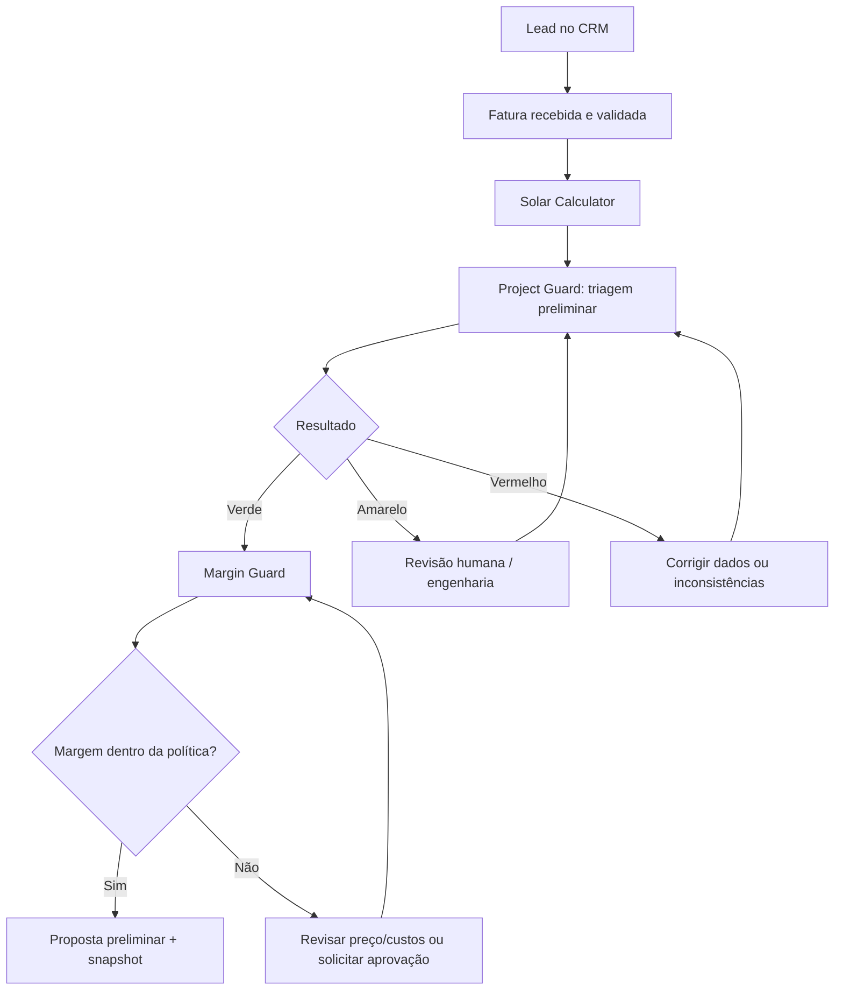

# Voltex SolTech — Reestruturação de produto e prioridades de desenvolvimento

**Versão:** 1.0 — 18/10/2026  
**Base:** `Modelagem_Completa_CRM_Solar_Hydra_Labs.md` (setembro/2026)  
**Finalidade:** orientar a continuidade do desenvolvimento com auxílio de LLM, sem substituir a modelagem original.  
**Status:** proposta de atualização do roadmap, não especificação de funcionalidades já implementadas.

## 1. Contexto e decisão

A Voltex SolTech mantém a proposta original: **um ecossistema de quatro produtos independentes e integrados**, voltado a empresas integradoras de energia fotovoltaica. A mudança é de **posicionamento e priorização**, não de arquitetura ou de quantidade de produtos.

**Posicionamento proposto:** ajudar a integradora a transformar um lead em uma proposta comercial **com premissas rastreáveis, triagem de riscos técnicos/regulatórios e controle de rentabilidade**. Diferenciar-se pela qualidade das decisões antes da venda, e não somente pela quantidade de funcionalidades de CRM.

> A diferenciação é uma hipótese comercial a validar com integradoras. Nenhuma funcionalidade descrita neste documento deve ser considerada pronta sem inspeção do repositório e testes.

## 2. O que permanece da modelagem original

| Produto / camada | Responsabilidade preservada |
|---|---|
| **CRM Solar** | Leads, funil, relacionamento, propostas, contratos, margem, homologação, execução, financeiro e pós-venda. |
| **Solar Calculator** | Pré-dimensionamento, geração, economia, payback e semáforo de pré-viabilidade. |
| **Solar Engine Studio** | Projeto elétrico/fotovoltaico aprofundado, compatibilidade de módulos/inversores/strings/MPPT, simulação e relatórios técnicos. |
| **Off-Grid Designer** | Cargas, autonomia, baterias, inversores, controladores, backup e cenários off-grid/híbridos. |
| **Serviços compartilhados** | Identidade, documentos/OCR, catálogo, Rules Engine, integrações, IA, auditoria e analytics. |

**Invariantes:** não criar um quinto produto; não juntar toda a engenharia no CRM; não duplicar dados entre módulos; manter as fontes de verdade por domínio, IDs de projeto e snapshots imutáveis; preservar validações determinísticas e aprovação humana em decisões críticas.

## 3. O que muda em relação à modelagem original

| Tema | Modelagem original | Atualização proposta |
|---|---|---|
| **Proposta de valor** | Suíte integrada para todas as etapas da integradora. | Entrada comercial centrada em **prevenir propostas com inconsistências técnicas, regulatórias ou financeiras**. |
| **Project Guard** | Capacidades distribuídas entre `Regulation-as-Code` (7.1), `Connection Feasibility` (7.3), semáforo (14) e Rules Engine (40–41). | Dar nome e experiência única à **triagem técnico-comercial**; **não** criar novo sistema ou novo motor de cálculo. |
| **Prioridade de regras** | Rules Engine técnico mais completo planejado no MVP 2. | **Antecipar apenas verificações mínimas e versionadas** ao MVP 1; manter regras complexas e validações elétricas aprofundadas no MVP 2. |
| **Margem** | `Margin Guard` já presente (7.2 e 8.9). | Torná-lo parte obrigatória do fluxo de liberação da proposta no MVP 1. |
| **Registro da decisão** | Snapshots, aprovações, versionamento e relatórios já especificados (33, 17.12 e 41). | Definir um **relatório consolidado de triagem comercial** com alertas, premissas, versões e responsáveis. |
| **Sequência de entrega** | CRM + Calculator → Engine → Off-Grid → operação/O&M. | **Manter a sequência**, dando prioridade explícita ao ciclo *fatura → cálculo → triagem → margem → proposta*. |

**Escopo realmente novo a detalhar:** contrato funcional do Project Guard (entradas, alertas, estados, condições de bloqueio, permissões e saída consolidada). Os componentes técnicos subjacentes já estão previstos no documento original.

## 4. Definição do Voltex Project Guard

**Natureza:** capacidade transversal que orquestra informações do CRM, Calculator, Margin Guard e regras selecionadas do Rules Engine. Não substitui o Solar Engine Studio nem o profissional responsável pelo projeto.

**Entradas mínimas:** dados do cliente/local, distribuidora, consumo/fatura validada, premissas do cálculo, equipamentos e custos disponíveis, regras aplicáveis com origem e vigência.

**Saídas mínimas:** alertas técnico-comerciais, campos faltantes, risco/necessidade de revisão, margem estimada, justificativas e relatório/snapshot versionado.

**Estados de triagem:**

- **Verde — apto à proposta preliminar:** verificações do escopo inicial satisfeitas, sem garantia de aprovação técnica ou de conexão.
- **Amarelo — revisão necessária:** informação crítica ausente, cenário complexo ou risco que exige análise humana/engenharia.
- **Vermelho — bloqueio configurado:** inconsistência conhecida, regra violada ou dado inválido; liberar somente após correção ou aprovação formal conforme política definida.

**Limite de segurança:** a conta de energia e uma calculadora não bastam para atestar viabilidade de conexão, ausência de inversão de fluxo ou conformidade integral. A ferramenta deve indicar *triagem*, não emitir homologação nem aprovação de engenharia por conta própria. IA pode extrair/sugerir, mas não validar cálculos elétricos críticos de forma autônoma.

## 5. Nova ordem de implementação

### Fase 0 — Auditoria do desenvolvimento existente (antes de alterar código)

- [ ] Inspecionar repositório, módulos, banco, APIs, migrações, testes e funcionalidades já prontas ou parcialmente prontas.
- [ ] Mapear requisitos originais versus código existente: **implementado / parcial / ausente / precisa refatoração**.
- [ ] Preservar contratos, dados e fluxos em produção; propor migrações somente se indispensáveis.
- [ ] Abrir backlog incremental por dependências; não reimplementar o que já funciona.

### MVP 1 — Núcleo técnico-comercial vendável (prioridade máxima)

- [ ] **CRM essencial:** cliente, lead, oportunidade, pipeline, tarefas e vínculo global do projeto.
- [ ] **Entrada de dados:** upload e OCR da fatura, score de confiança e confirmação/correção manual.
- [ ] **Solar Calculator:** consumo, potência preliminar, geração, economia, payback e semáforo.
- [ ] **Project Guard básico:** dados obrigatórios, inconsistências, alertas por regras selecionadas, revisão humana e status da triagem.
- [ ] **Margin Guard:** custos principais, margem estimada, limite mínimo e fluxo de autorização quando necessário.
- [ ] **Proposta + rastreabilidade:** gerar proposta preliminar com premissas, alertas, versão das regras/cálculo, responsável e snapshot imutável.

**Critério de saída do MVP 1:** um usuário percorre *lead → fatura validada → cálculo preliminar → triagem → margem → proposta*, sem redigitação desnecessária; erros e alertas relevantes ficam registrados e casos críticos são encaminhados à revisão.

### MVP 2 — Engenharia e validação aprofundadas

- [ ] Solar Engine Studio: catálogos, strings, MPPT, compatibilidade, proteções, simulação e relatórios.
- [ ] Expandir Rules Engine com regras técnicas/regulatórias versionadas, fontes, testes e revisão por especialista.
- [ ] Conectar parecer técnico aprovado ao Project Guard/CRM por snapshot; reavaliar resultados quando entradas mudarem.

### MVP 3 — Off-Grid Designer

- [ ] Perfil de cargas, autonomia, geração, banco de baterias, inversores/controladores, backup e comparação de cenários.
- [ ] Integrar o resultado aprovado ao CRM e ao histórico técnico do projeto.

### Fases posteriores — Operação e inteligência

- [ ] Instalação, field service, comissionamento, portal do cliente, garantias e O&M.
- [ ] IA operacional avançada, otimização de compras, analytics, previsões e outras capacidades da modelagem original.

## 6. Fluxo prioritário do MVP 1

## 7. Requisitos mínimos de qualidade e critérios de aceite

- [ ] **Cálculo rastreável:** entradas, unidades, premissas, algoritmo/versionamento, tolerâncias e testes.
- [ ] **Regra rastreável:** identificação, fonte oficial, distribuidora/região/escopo, vigência, versão e responsável técnico pela revisão.
- [ ] **Segurança:** isolamento por empresa, RBAC, registros de auditoria e tratamento adequado de dados pessoais (LGPD).
- [ ] **Controle humano:** revisão obrigatória de campos OCR incertos, exceções financeiras e decisões técnicas críticas.
- [ ] **Consistência:** alteração de fatura, equipamento, custo ou premissa invalida/gera nova avaliação quando necessário; versões anteriores permanecem acessíveis.
- [ ] **Integração incremental:** reaproveitar dados e serviços existentes, com testes de regressão antes de alterar contratos de APIs ou modelo de dados.

## 8. Orientação ao LLM responsável pelo desenvolvimento

> Use este arquivo como **adendo de prioridades** à modelagem completa; em caso de conflito, preserve a arquitetura e as regras de segurança da modelagem original e sinalize o conflito explicitamente. **Primeiro analise o código existente**, compare-o ao MVP 1 e produza um diagnóstico de lacunas e dependências. Em seguida, proponha tarefas pequenas e verificáveis, na ordem do item 5. Não crie novo sistema/microserviço apenas para o Project Guard, não renomeie componentes já funcionais sem necessidade e não afirme que um recurso está implementado sem evidência no repositório. Antes de codificar regras elétricas ou regulatórias, exija fontes oficiais vigentes, testes e revisão técnica. Não apresente uma triagem automatizada como homologação ou aprovação técnica definitiva.

## 9. Resultado esperado

A primeira versão comercial da Voltex deve entregar **um fluxo confiável e auditável de pré-venda solar**, com foco em reduzir retrabalho, evidenciar riscos e proteger margens. A expansão para engenharia, off-grid e operação continua no roadmap original; a velocidade de evolução depende de validação técnica e uso real pelas integradoras.

---

**Referências internas à modelagem original:** seções 3, 7.1–7.5, 8.7–8.10, 11–15, 17, 20–29, 30–33, 40–41, 54, 63–69, 70–76 e 83–84.
