# Modelagem completa do ecossistema de software para integradores fotovoltaicos

**Empresa:** Hydra Labs  
**Documento:** Arquitetura funcional, fluxos, domínios, integrações e roadmap  
**Status:** Documento de produto e arquitetura — versão inicial para validação  
**Data:** setembro de 2026

> **Nota de nomenclatura:** este documento usa nomes funcionais (`CRM Solar`, `Solar Calculator`, `Solar Engine Studio` e `Off-Grid Designer`). Eles podem ser substituídos posteriormente pela marca escolhida, como Gridra, Solvix, Fluxeira, Next Grid, Solar Zone, Grid Flow ou Voltix.

---

## 1. Objetivo do produto

A proposta é construir um **ecossistema de quatro sistemas independentes, porém integrados**, voltado a empresas que vendem, projetam, instalam, homologam e mantêm sistemas de energia fotovoltaica.

O objetivo não é criar apenas mais um CRM com Kanban e cadastro de clientes. O produto deve cobrir o ciclo completo da operação da integradora, preservando uma separação clara entre:

1. **gestão comercial e operacional**;
2. **cálculos comerciais rápidos**;
3. **engenharia fotovoltaica avançada**;
4. **dimensionamento especializado de sistemas off-grid**.

A arquitetura deve permitir que cada sistema seja vendido e utilizado isoladamente, mas que a experiência mais completa aconteça quando todos estiverem conectados.

---

## 2. Base conceitual utilizada

Esta modelagem parte de duas bases principais.

### 2.1. Padrões observados no mercado de CRM solar

A análise anterior considerou plataformas como **Azume, SolarMarket, SolarZ, Luvik, Groner, 77Sol, Solfácil, Solaris Control, Solaryum e Solarfy**.

Os padrões de mercado consolidados que devem ser tratados como **baseline competitivo**, e não como diferenciais suficientes por si só, são:

- CRM e funil de vendas;
- geração de propostas;
- cálculo de economia e payback;
- leitura de conta de energia;
- Grupo A e Grupo B;
- integração com WhatsApp;
- tarefas e automações;
- homologação e projetos;
- integração com fornecedores/distribuidores;
- financiamento;
- acompanhamento de instalação;
- financeiro por projeto;
- monitoramento e O&M;
- uso de IA para preenchimento, leitura de documentos e operação do fluxo;
- BESS, sistemas híbridos e Grid Zero em diferentes níveis de profundidade.

### 2.2. Material técnico de energia fotovoltaica

O material **Energia Fotovoltaica — EnergIF / IFSC / ENBPar, 2023** cobre fundamentos, componentes, sistemas on-grid, off-grid e híbridos, dimensionamento, ferramentas computacionais, acesso à rede, instalação, segurança, conexões elétricas, comissionamento e manutenção.

O documento técnico reforça que o software de engenharia pode estruturar informações como:

- orientação e inclinação de módulos;
- sombreamento;
- recurso solar;
- Pmpp, Vmpp, Impp, Voc e Isc;
- associação série/paralelo;
- faixas de MPPT;
- limites de tensão e corrente de inversores;
- dimensionamento de sistemas on-grid;
- perfil e análise de carga;
- banco de baterias;
- autonomia;
- controladores de carga;
- proteções CC e CA;
- cabos;
- aterramento;
- procedimentos de instalação;
- ensaios de comissionamento;
- start-up;
- manutenção e supervisão.

> **Importante:** o material técnico é de 2023 e contém referências regulatórias e normativas que podem ter sido alteradas. Conceitos físicos e elétricos estáveis podem alimentar o motor de cálculo. Regras regulatórias, normas e exigências de concessionárias devem ser tratadas em um mecanismo versionado e atualizável, nunca codificadas de forma fixa apenas a partir do material.

---

# PARTE I — VISÃO DO ECOSSISTEMA

## 3. Sistemas do ecossistema

| Sistema | Papel principal | Usuário principal | Pode ser vendido separadamente? |
|---|---|---|---|
| **CRM Solar** | Comercial, operação, projetos, homologação, instalação, financeiro e pós-venda | Dono, gestor, SDR, vendedor, engenharia, financeiro e operação | Sim |
| **Solar Calculator** | Cálculo rápido de pré-viabilidade e proposta comercial | SDR, vendedor, consultor | Sim |
| **Solar Engine Studio** | Projeto e validação técnica fotovoltaica avançada | Engenheiro, projetista, responsável técnico | Sim |
| **Off-Grid Designer** | Dimensionamento de cargas, geração, armazenamento e autonomia | Engenheiro, projetista, integrador off-grid | Sim |

Além dos quatro produtos, haverá serviços compartilhados, como autenticação, catálogo de equipamentos, motor de regras, documentos, IA, integrações e analytics.

---

## 4. Diagrama de contexto do ecossistema

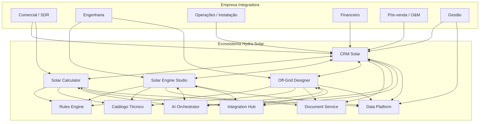

---

## 5. Princípio de separação entre os sistemas

A separação existe para evitar que o CRM se transforme em um monólito de produto impossível de manter.

### CRM Solar é dono de:

- clientes;
- leads;
- oportunidades;
- funis;
- tarefas;
- comunicações;
- propostas comerciais;
- contratos;
- financiamento;
- homologação;
- instalação;
- financeiro por projeto;
- pós-venda;
- O&M;
- relacionamento e lifecycle do cliente.

### Solar Calculator é dono de:

- sessões de cálculo rápido;
- premissas comerciais;
- consumo utilizado;
- estimativa de potência;
- geração estimada;
- economia estimada;
- payback preliminar;
- cenários comerciais rápidos.

### Solar Engine Studio é dono de:

- modelo técnico da instalação;
- superfícies/telhados;
- obstáculos e sombreamento;
- recurso solar;
- módulos;
- inversores;
- strings;
- MPPTs;
- proteções;
- cabos;
- verificações técnicas;
- simulação energética;
- desenhos e relatórios técnicos;
- versão aprovada do projeto.

### Off-Grid Designer é dono de:

- equipamentos/cargas;
- perfil de consumo;
- criticidade das cargas;
- autonomia;
- banco de baterias;
- profundidade de descarga;
- controlador de carga;
- inversor off-grid/híbrido;
- gerador de backup;
- cenários de disponibilidade e custo.

---

# PARTE II — PADRÃO DE MERCADO E POSICIONAMENTO

## 6. O que o mercado já entrega e deve existir no produto

| Capacidade | Referências observadas | Decisão para o ecossistema |
|---|---|---|
| CRM + propostas | Azume, Luvik, Solarfy, SolarMarket | Obrigatório |
| Proposta rápida | Solarfy, Azume | Obrigatório no Solar Calculator |
| OCR de fatura | Luvik, SolarMarket e outros | Obrigatório |
| Grupo A/B | Luvik, Solarfy e concorrentes técnicos | Obrigatório |
| Grid Zero | Luvik e plataformas de engenharia | Obrigatório no Engine |
| BESS/híbridos | Azume, Luvik, Solfácil | Evolução do Engine e Off-Grid |
| WhatsApp | SolarMarket, Groner, SolarZ | Obrigatório no CRM |
| IA operacional | SolarMarket, Groner | Obrigatório como camada assistiva |
| Margem e DRE | SolarMarket, Groner, Solaris | Obrigatório |
| Homologação | 77Sol, Solaryum e outros | Obrigatório |
| Venda → projeto | Solaryum, Groner | Obrigatório |
| Field service | Groner, Solaris e plataformas amplas | Fase 2 |
| Monitoramento/O&M | SolarZ, Groner, Solaris | Fase 2/3 |
| Financiamento | 77Sol, Solfácil, Luvik | Integração no MVP; originar crédito depois |
| Marketplace/cotação | 77Sol, SolarMarket | Integração e otimização, sem tentar recriar marketplace no MVP |
| ERP/estoque/fiscal | Solaris, Groner | Integração primeiro; construir apenas se houver demanda validada |

---

## 7. Diferenciais propostos

Estes elementos devem ser tratados como as principais hipóteses de diferenciação.

### 7.1. Regulation-as-Code

Motor versionado de regras por:

- concessionária/distribuidora;
- grupo tarifário;
- tipo de instalação;
- data de vigência;
- região;
- tipo de projeto;
- norma/regra aplicável.

Cada cálculo ou proposta deve guardar **qual versão da regra foi utilizada**.

### 7.2. Margin Guard

O CRM não deve permitir que o vendedor olhe apenas o preço de venda.

O projeto deve consolidar:

- kit;
- módulos;
- inversores;
- estruturas;
- proteções;
- cabos;
- frete;
- instalação;
- deslocamento;
- comissão;
- impostos;
- custo financeiro;
- contingência;
- retrabalho previsto;
- margem mínima exigida.

### 7.3. Connection Feasibility

Antes de uma proposta definitiva, o sistema pode produzir uma triagem de:

- demanda contratada;
- capacidade de inversor;
- injeção;
- Grid Zero;
- inversão de fluxo;
- documentação faltante;
- necessidade de validação técnica adicional.

### 7.4. Project Digital Thread

Um único `Project ID` acompanha todo o ciclo:

**Lead → oportunidade → cálculo → engenharia → cotação → proposta → contrato → homologação → instalação → comissionamento → O&M.**

Não deve existir recadastro manual entre departamentos.

### 7.5. Evidence Pack

O sistema organiza automaticamente:

- documentos;
- versões;
- fotos;
- localização;
- checklists;
- aceite;
- assinatura;
- medições;
- serial dos equipamentos;
- relatórios de comissionamento;
- logs.

### 7.6. AI Workflow Operator

A IA deve operar tarefas burocráticas, mas não substituir o motor determinístico de cálculo.

Pode:

- ler faturas;
- resumir WhatsApp;
- preencher cadastro;
- sugerir próxima ação;
- montar tarefas;
- criar rascunho de proposta;
- detectar pendências;
- explicar alertas técnicos.

Não deve decidir autonomamente sem aprovação humana:

- preço final;
- margem abaixo do limite;
- crédito;
- alteração contratual;
- aprovação técnica;
- cálculo elétrico crítico.

---

# PARTE III — CRM SOLAR

## 8. Módulos do CRM

### 8.1. Administração e tenancy

- cadastro da empresa;
- filiais;
- times;
- usuários;
- perfis e permissões;
- campos personalizados;
- pipelines personalizados;
- templates;
- políticas de margem;
- integrações;
- regras de automação;
- auditoria.

### 8.2. Leads e captação

Origens:

- formulário;
- landing page;
- WhatsApp;
- API;
- indicação;
- importação CSV;
- marketplace;
- campanha;
- cadastro manual;
- portal/parceiro.

Funções:

- deduplicação;
- lead scoring;
- roteamento automático;
- SLA de primeiro contato;
- tracking de origem;
- UTM;
- classificação residencial, rural, comercial ou industrial;
- classificação Grupo A/B preliminar.

### 8.3. Contas, contatos e unidades consumidoras

Uma conta pode possuir:

- vários contatos;
- vários imóveis;
- várias unidades consumidoras;
- vários projetos;
- várias usinas instaladas;
- diferentes responsáveis financeiros e técnicos.

### 8.4. Inbox e comunicação

- WhatsApp oficial;
- e-mail;
- notas internas;
- mensagens automáticas;
- templates;
- histórico completo;
- gravação de origem da mensagem;
- associação automática a lead/oportunidade;
- resumo por IA.

### 8.5. Oportunidades e pipeline

Pipeline padrão sugerido:

1. Novo lead;
2. Primeiro contato;
3. Qualificação;
4. Fatura pendente;
5. Pré-dimensionamento;
6. Visita técnica necessária;
7. Engenharia necessária;
8. Cotação;
9. Proposta pronta;
10. Proposta enviada;
11. Negociação;
12. Crédito/financiamento;
13. Contrato;
14. Ganho;
15. Perdido.

O pipeline deve ser personalizável.

### 8.6. Intake técnico

Cadastro progressivo, evitando formulários longos no início.

Dados iniciais:

- cliente;
- local;
- concessionária;
- número da UC;
- conta de energia;
- consumo;
- grupo tarifário;
- padrão de entrada;
- disponibilidade de área;
- tipo de telhado;
- interesse em on-grid, híbrido ou off-grid.

### 8.7. OCR de conta de energia

Fluxo:

1. usuário envia PDF/foto;
2. OCR extrai campos;
3. campos recebem score de confiança;
4. campos incertos são destacados;
5. usuário confirma/corrige;
6. versão validada vira `EnergyBillSnapshot`;
7. dados alimentam Calculator/Engine.

### 8.8. Cotação e procurement

- BOM inicial;
- solicitação de cotação;
- múltiplos fornecedores;
- preço;
- prazo;
- frete;
- estoque;
- garantia;
- compatibilidade técnica;
- SLA histórico;
- comparação de opções.

### 8.9. Margem

Para cada cenário:

```text
Receita bruta
- equipamentos
- frete
- estrutura
- instalação
- mão de obra
- comissão
- impostos
- financiamento
- deslocamento
- terceiros
- contingência
= margem de contribuição estimada
```

Regras possíveis:

- margem mínima por equipe;
- margem mínima por tipo de projeto;
- aprovação de desconto;
- bloqueio de proposta;
- justificativa obrigatória;
- trilha de auditoria.

### 8.10. Propostas

- PDF;
- proposta Web;
- marca da integradora;
- múltiplos cenários;
- economia;
- payback;
- equipamentos;
- condições comerciais;
- financiamento;
- garantias;
- anexos técnicos;
- rastreamento de abertura;
- aceite;
- versionamento.

### 8.11. Contratos e assinatura

- geração por template;
- variáveis automáticas;
- assinatura eletrônica;
- status;
- testemunhas;
- armazenamento do documento final;
- evento `ContractSigned`.

### 8.12. Financiamento

- múltiplos parceiros;
- simulação;
- submissão;
- status;
- pendências;
- aprovação/reprovação;
- prazo;
- taxa;
- documentação.

O CRM deve ser neutro em relação a instituições financeiras sempre que possível.

### 8.13. Projeto e homologação

Após `DealWon`, o negócio deve automaticamente virar projeto.

Itens:

- responsável técnico;
- status da engenharia;
- documentação;
- ART/RRT quando aplicável;
- checklist por concessionária;
- solicitação de acesso;
- pendências;
- parecer;
- vistoria;
- aprovação;
- datas e SLA.

### 8.14. Field Service

- visita técnica;
- agenda;
- equipes;
- rota;
- checklist;
- modo offline;
- fotos;
- geolocalização;
- materiais;
- assinatura;
- evidências.

### 8.15. Instalação

Status sugeridos:

1. aguardando engenharia;
2. aguardando material;
3. material separado;
4. agendamento;
5. equipe designada;
6. em instalação;
7. pendência de campo;
8. instalação concluída;
9. comissionamento;
10. aceite do cliente;
11. finalizado.

### 8.16. Comissionamento

O módulo de campo deve permitir checklists de ensaio e evidências. O material técnico utilizado como base descreve ensaios padrão e expandidos, inspeções, start-up do inversor e relatório de conclusão.

Itens possíveis:

- continuidade/equipotencialização;
- polaridade;
- verificação de caixas e conexões;
- medições por string;
- aterramento;
- inspeção térmica quando aplicável;
- start-up;
- parâmetros do inversor;
- fotos;
- relatório final.

### 8.17. Pós-venda e O&M

- planta instalada;
- equipamentos e seriais;
- garantias;
- tickets;
- manutenção preventiva;
- manutenção corretiva;
- monitoramento via integração;
- alertas;
- contratos recorrentes;
- limpeza;
- expansão;
- bateria;
- carregador VE;
- indicação;
- renovação.

### 8.18. Financeiro por projeto

No MVP não precisa ser ERP fiscal completo.

Precisa controlar:

- previsto x realizado;
- recebimentos;
- parcelas;
- inadimplência;
- custos;
- comissões;
- margem real;
- rentabilidade por projeto;
- rentabilidade por vendedor;
- rentabilidade por canal.

---

## 9. Fluxo principal do CRM

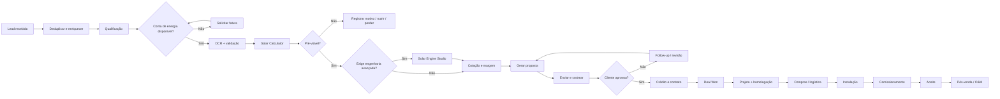

---

## 10. Máquina de estados da oportunidade

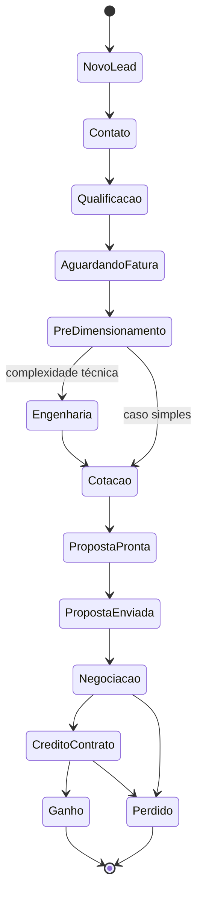

---

# PARTE IV — SOLAR CALCULATOR

## 11. Objetivo

O Solar Calculator é uma ferramenta rápida para uso comercial. Ele não substitui um projeto de engenharia.

A missão é responder rapidamente:

- qual potência aproximada seria necessária?;
- quantos módulos aproximadamente?;
- qual geração esperada?;
- qual economia?;
- qual investimento estimado?;
- qual payback preliminar?;
- vale a pena avançar para engenharia?

---

## 12. Entradas do Solar Calculator

### Cliente/local

- endereço;
- CEP;
- latitude/longitude;
- concessionária;
- perfil residencial/comercial/rural/industrial.

### Energia

- consumo mensal;
- histórico de 12 meses;
- tarifa;
- grupo;
- modalidade;
- demanda, quando aplicável;
- simultaneidade, quando necessária.

### Projeto preliminar

- potência do módulo;
- perdas estimadas;
- irradiação/HSP;
- orientação aproximada;
- inclinação aproximada;
- área disponível.

### Financeiro

- custo/Wp ou kit estimado;
- mão de obra;
- margem;
- taxa de reajuste configurável;
- financiamento opcional.

---

## 13. Saídas do Solar Calculator

- consumo anual;
- potência FV estimada;
- quantidade aproximada de módulos;
- área aproximada;
- geração mensal/anual;
- percentual de compensação;
- economia anual;
- economia acumulada;
- investimento;
- payback simples;
- fluxo de caixa preliminar;
- alertas;
- score de confiança do cálculo;
- necessidade de encaminhar ao Engine Studio.

---

## 14. Semáforo de pré-viabilidade

### Verde

- dados suficientes;
- cálculo dentro das premissas comuns;
- sem alerta técnico relevante;
- pode seguir para proposta preliminar.

### Amarelo

- dado crítico ausente;
- demanda contratada relevante;
- possível Grid Zero;
- sombreamento relevante;
- Grupo A complexo;
- híbrido/BESS;
- limites técnicos próximos.

Ação: encaminhar para Solar Engine Studio.

### Vermelho

- inconsistência;
- área insuficiente;
- premissa incompatível;
- cálculo fora de regra configurada;
- necessidade explícita de revisão técnica.

---

## 15. Fluxo da calculadora

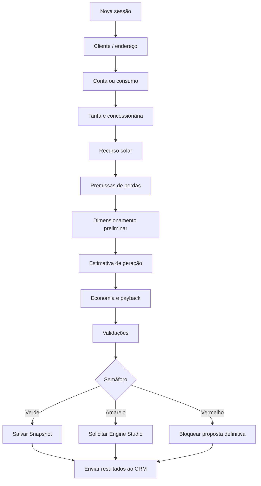

---

# PARTE V — SOLAR ENGINE STUDIO

## 16. Objetivo

O Solar Engine Studio é a ferramenta avançada de projeto, dimensionamento e validação técnica.

Ele deve funcionar como produto independente e também como braço técnico do CRM.

---

## 17. Módulos do Engine Studio

### 17.1. Projeto

- nome;
- cliente;
- endereço;
- coordenadas;
- tipo de instalação;
- tensão;
- concessionária;
- responsável técnico;
- versão.

### 17.2. Recurso solar

- fonte dos dados;
- HSP/irradiância;
- série temporal quando disponível;
- temperatura;
- perdas ambientais;
- versão da fonte.

### 17.3. Modelagem de superfície

- área útil;
- orientação;
- inclinação;
- obstáculos;
- recuos;
- sombreamento;
- layout dos módulos.

Em versões futuras pode evoluir para desenho 2D/3D mais completo.

### 17.4. Catálogo de módulos

Campos principais:

- fabricante;
- modelo;
- Pmpp;
- Vmpp;
- Impp;
- Voc;
- Isc;
- eficiência;
- coeficiente térmico de Pmax;
- coeficiente de Voc;
- coeficiente de Isc;
- dimensão;
- peso;
- tecnologia;
- garantia;
- datasheet.

### 17.5. Catálogo de inversores

- fabricante;
- modelo;
- potência CC máxima;
- potência CA nominal;
- tensão CC máxima;
- faixa MPPT;
- corrente máxima por MPPT;
- corrente de curto-circuito admissível;
- quantidade de MPPTs;
- entradas por MPPT;
- tensão nominal CA;
- fases;
- eficiência;
- datasheet.

### 17.6. String Designer

Funções:

- criar strings;
- associar strings a MPPT;
- calcular tensão/corrente;
- considerar temperatura de projeto;
- validar Voc máximo;
- validar faixa MPPT;
- validar corrente;
- validar potência;
- alertar desbalanceamento.

### 17.7. Compatibility Engine

Status:

- `VALID`;
- `VALID_WITH_WARNINGS`;
- `INVALID`.

Exemplos:

- Voc corrigido excede entrada máxima;
- Vmpp fora da faixa MPPT;
- corrente excedida;
- relação DC/AC fora da política;
- quantidade incompatível;
- equipamento não homologado na política interna.

### 17.8. Proteções e cabos

- String Box;
- seccionamento;
- fusível;
- DPS;
- disjuntor;
- DR quando aplicável;
- aterramento;
- cabo CC;
- cabo CA;
- queda de tensão;
- distância.

### 17.9. Simulação energética

- geração mensal;
- geração anual;
- perdas;
- performance ratio;
- clipping;
- sombreamento;
- degradação configurável;
- comparação de cenários.

### 17.10. Grid / conexão

- injeção estimada;
- potência do inversor;
- demanda contratada;
- possibilidade de Grid Zero;
- alerta de inversão de fluxo;
- checklist de acesso;
- regras por concessionária.

### 17.11. Viabilidade econômica

- CAPEX;
- OPEX;
- economia;
- payback;
- fluxo de caixa;
- tarifa;
- cenários;
- financiamento;
- sensibilidade.

### 17.12. Relatórios

- memorial de cálculo;
- ficha técnica;
- relatório de compatibilidade;
- relatório de geração;
- lista de materiais;
- premissas utilizadas;
- alertas;
- versão de regras;
- anexos.

---

## 18. Fluxo do Solar Engine Studio

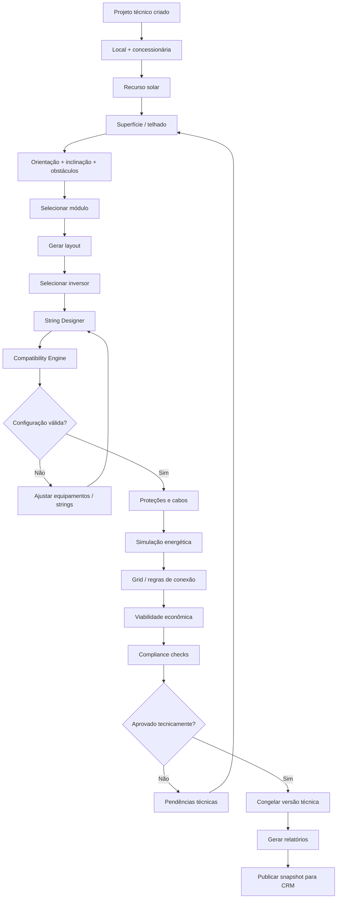

---

## 19. Fluxo de validação módulo × inversor

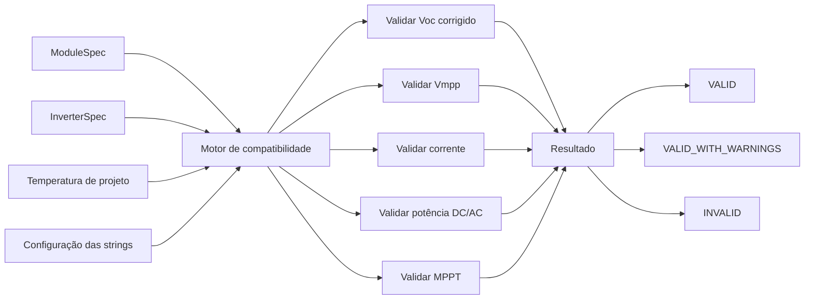

---

# PARTE VI — OFF-GRID DESIGNER

## 20. Objetivo

O Off-Grid Designer é um produto especializado para sistemas isolados, híbridos e soluções com armazenamento.

Sua lógica começa pela **carga**, e não apenas pela conta de energia.

---

## 21. Cadastro de cargas

Para cada carga:

- nome;
- categoria;
- quantidade;
- potência nominal;
- potência de partida;
- corrente;
- tensão;
- horas/dia;
- dias/semana;
- janela de uso;
- criticidade;
- simultaneidade;
- sazonalidade.

Exemplos:

- iluminação;
- geladeira;
- freezer;
- bomba;
- motor;
- irrigação;
- telecom;
- refrigeração;
- equipamentos industriais.

---

## 22. Perfil de carga

O sistema deve gerar:

- Wh/dia;
- kWh/dia;
- pico de potência;
- pico de partida;
- carga crítica;
- curva horária aproximada;
- consumo diurno/noturno;
- sazonalidade.

---

## 23. Autonomia

Entradas:

- horas/dias de autonomia;
- disponibilidade desejada;
- profundidade de descarga máxima;
- eficiência do banco;
- temperatura;
- envelhecimento/degradação;
- reserva técnica.

---

## 24. Banco de baterias

O sistema deve calcular e validar:

- energia útil necessária;
- energia nominal necessária;
- tensão do banco;
- número de baterias em série;
- número de strings em paralelo;
- capacidade total;
- DoD;
- ciclos;
- corrente de carga/descarga;
- compatibilidade com inversor/controlador;
- expansão futura.

---

## 25. Controlador de carga

Suporte a:

- MPPT;
- PWM, quando aplicável;
- tensão de banco;
- potência FV;
- corrente máxima;
- limite de entrada;
- compatibilidade.

---

## 26. Inversor off-grid / híbrido

Validações:

- potência contínua;
- surto/partida;
- tensão do banco;
- compatibilidade da bateria;
- carregador integrado;
- MPPT integrado;
- entrada de gerador;
- saída CA;
- fases.

---

## 27. Gerador de backup

Cenários:

- sem gerador;
- gerador emergencial;
- gerador por limiar de SOC;
- operação híbrida;
- custo de combustível;
- horas previstas;
- custo de operação.

---

## 28. Comparação de cenários off-grid

Exemplo:

| Cenário | FV | Bateria | Gerador | Autonomia | CAPEX | Risco |
|---|---:|---:|---:|---:|---:|---|
| A | Médio | Grande | Não | Alta | Alto | Baixo |
| B | Médio | Médio | Sim | Média | Médio | Médio |
| C | Grande | Pequena | Sim | Baixa | Médio | Dependente do gerador |

---

## 29. Fluxo do Off-Grid Designer

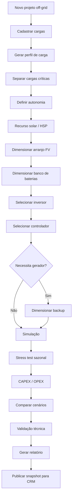

---

# PARTE VII — INTEGRAÇÃO ENTRE OS QUATRO SISTEMAS

## 30. Fluxo de decisão técnica

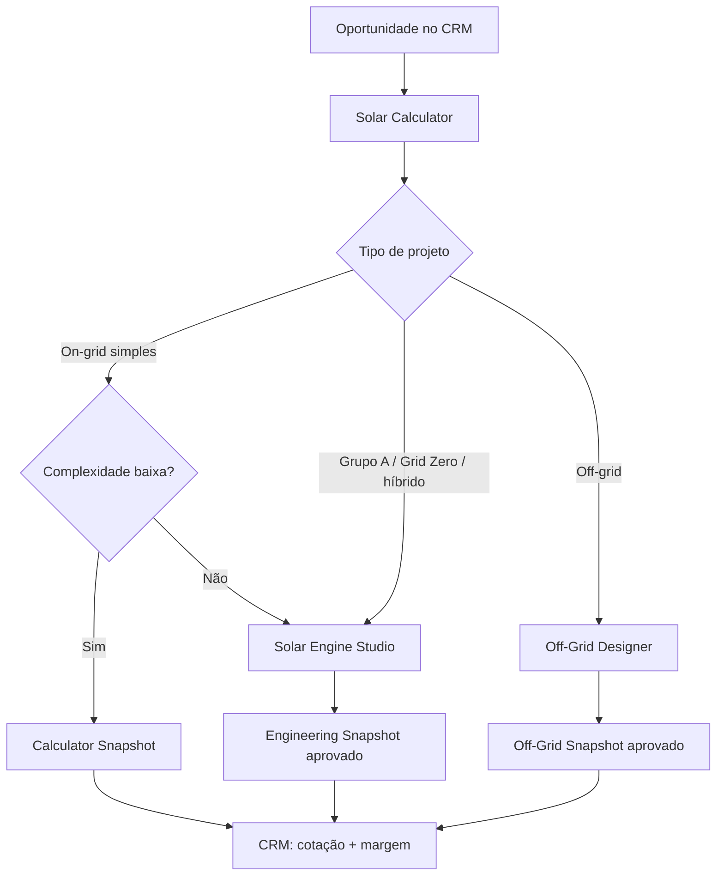

---

## 31. Sequência CRM → Calculator → Engine

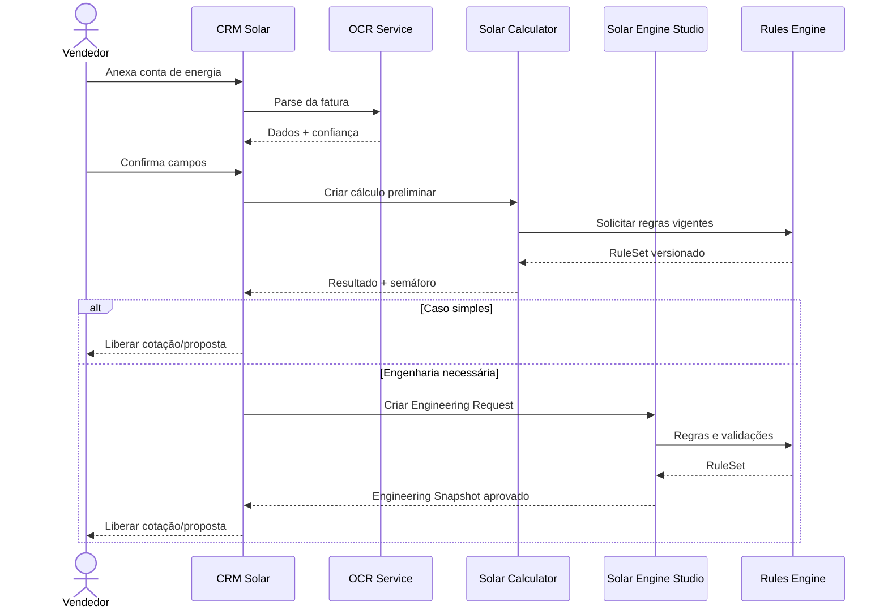

---

## 32. Source of Truth por domínio

| Informação | Sistema de origem |
|---|---|
| Lead, conta, contato | CRM |
| Oportunidade | CRM |
| Comunicação | CRM |
| Fatura validada | CRM / Document Service |
| Cálculo rápido | Solar Calculator |
| Projeto técnico | Solar Engine Studio |
| Projeto off-grid | Off-Grid Designer |
| Equipamentos técnicos | Catálogo compartilhado |
| Regras regulatórias | Rules Engine |
| Proposta comercial | CRM |
| Contrato | CRM |
| Homologação | CRM |
| Instalação | CRM |
| Planta instalada | CRM |
| Telemetria bruta | Integration Hub / plataforma de monitoramento |
| Métricas consolidadas | Data Platform |

---

## 33. Snapshot e imutabilidade

Nunca é recomendável que uma proposta antiga mude porque um preço ou regra foi atualizado.

Cada saída relevante deve criar um snapshot imutável contendo:

- inputs;
- outputs;
- versão do algoritmo;
- versão da regra;
- preços utilizados;
- equipamentos utilizados;
- usuário responsável;
- data/hora;
- avisos;
- aprovação técnica, quando aplicável.

Tipos:

- `QuickCalculationSnapshot`;
- `EngineeringSnapshot`;
- `OffGridSnapshot`;
- `QuoteSnapshot`;
- `ProposalSnapshot`.

---

# PARTE VIII — MODELO DE DADOS

## 34. Entidades principais do CRM

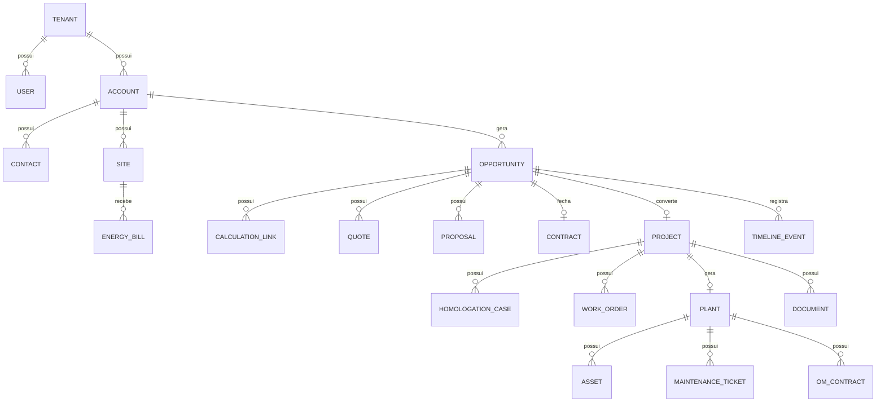

---

## 35. Entidades do Solar Engine Studio

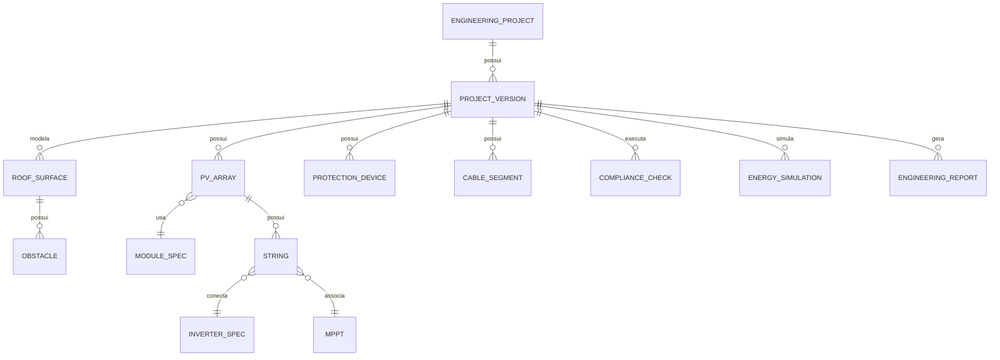

---

## 36. Entidades do Off-Grid Designer

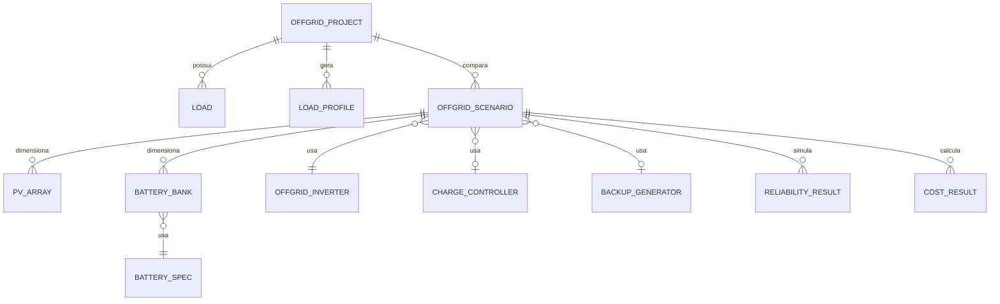

---

# PARTE IX — EVENTOS E APIs

## 37. Eventos de domínio

### Comercial

- `LeadCreated`
- `LeadQualified`
- `EnergyBillRequested`
- `EnergyBillParsed`
- `EnergyBillValidated`
- `OpportunityCreated`
- `OpportunityStageChanged`

### Cálculos

- `QuickCalculationRequested`
- `QuickCalculationCompleted`
- `EngineeringRequested`
- `EngineeringVersionApproved`
- `OffGridDesignRequested`
- `OffGridScenarioApproved`

### Venda

- `QuoteCreated`
- `MarginThresholdViolated`
- `ProposalGenerated`
- `ProposalViewed`
- `ProposalAccepted`
- `ContractSigned`
- `DealWon`

### Execução

- `HomologationStarted`
- `HomologationPending`
- `HomologationApproved`
- `MaterialsReady`
- `InstallationScheduled`
- `InstallationCompleted`
- `CommissioningCompleted`
- `CustomerAccepted`

### Lifecycle

- `PlantActivated`
- `MonitoringAlertReceived`
- `MaintenanceTicketCreated`
- `WarrantyExpiring`
- `OMRenewalDue`
- `UpsellOpportunityDetected`

---

## 38. Arquitetura baseada em eventos

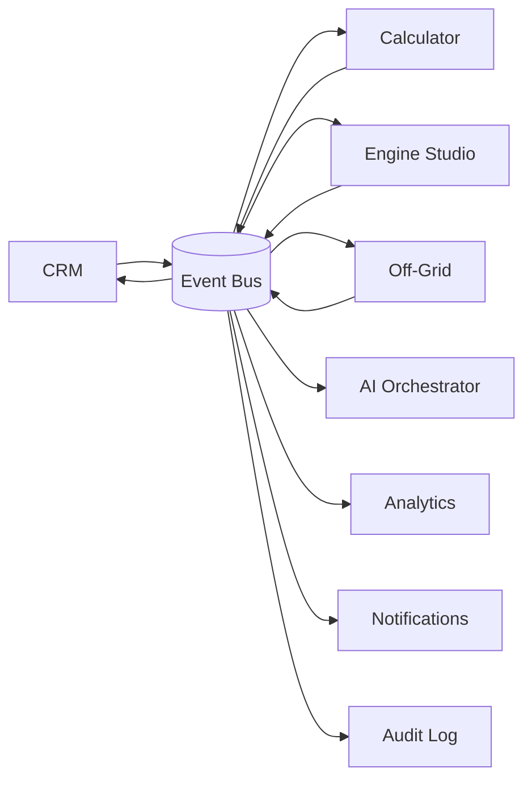

---

## 39. APIs principais — contrato conceitual

### CRM

```http
POST /api/v1/leads
POST /api/v1/opportunities
GET  /api/v1/opportunities/{id}
POST /api/v1/opportunities/{id}/stage
POST /api/v1/opportunities/{id}/engineering-request
POST /api/v1/opportunities/{id}/proposal
POST /api/v1/projects
GET  /api/v1/projects/{id}
```

### Documents / OCR

```http
POST /api/v1/documents
POST /api/v1/energy-bills/parse
POST /api/v1/energy-bills/{id}/validate
```

### Solar Calculator

```http
POST /api/v1/calculations/quick
GET  /api/v1/calculations/quick/{id}
POST /api/v1/calculations/quick/{id}/snapshot
```

### Solar Engine Studio

```http
POST /api/v1/engineering/projects
POST /api/v1/engineering/projects/{id}/versions
POST /api/v1/engineering/projects/{id}/validate
POST /api/v1/engineering/projects/{id}/approve
GET  /api/v1/engineering/projects/{id}/snapshot
```

### Off-Grid Designer

```http
POST /api/v1/offgrid/projects
POST /api/v1/offgrid/projects/{id}/loads
POST /api/v1/offgrid/projects/{id}/scenarios
POST /api/v1/offgrid/scenarios/{id}/simulate
POST /api/v1/offgrid/scenarios/{id}/approve
```

### Catálogo

```http
GET /api/v1/catalog/modules
GET /api/v1/catalog/inverters
GET /api/v1/catalog/batteries
GET /api/v1/catalog/controllers
POST /api/v1/catalog/equipment/import
```

---

# PARTE X — RULES ENGINE

## 40. Objetivo

Separar lógica física de lógica regulatória.

### Fórmulas e princípios físicos

Podem viver nos motores de cálculo versionados.

Exemplos:

- série/paralelo;
- potência;
- energia;
- correção térmica;
- curva de carga;
- capacidade de banco;
- eficiência;
- perdas.

### Regulação e compliance

Devem ser dados/regras versionadas.

Exemplos:

- regra por concessionária;
- documentação;
- tarifa;
- vigência;
- conexão;
- Grid Zero;
- políticas internas;
- normas e revisões.

---

## 41. Estrutura de uma regra

```yaml
id: rule_grid_connection_x
version: 7
status: active
valid_from: 2026-08-01
valid_to: null
distributor: DISTRIBUIDORA_X
region: CE
project_type: ON_GRID
customer_group: B
source:
  type: regulation
  reference: "documento oficial"
condition:
  field: inverter_ac_power
  operator: ">"
  value_from: contracted_demand
action:
  severity: warning
  code: DEMAND_REVIEW_REQUIRED
  message: "Revisar demanda antes de liberar o projeto."
reviewed_by: "responsável técnico"
```

---

# PARTE XI — AUTOMAÇÕES

## 42. Automações comerciais

- lead novo sem contato em X minutos → alertar;
- fatura solicitada e não recebida → follow-up;
- proposta visualizada → criar tarefa;
- proposta não aberta → mensagem diferente;
- negociação parada → notificar gestor;
- margem abaixo do limite → exigir aprovação;
- contrato assinado → criar projeto automaticamente.

## 43. Automações técnicas

- Calculator amarelo → criar Engineering Request;
- alteração de módulo → revalidar strings;
- atualização de regra → identificar projetos afetados;
- configuração inválida → bloquear aprovação;
- documento faltante → criar pendência;
- versão aprovada → congelar snapshot.

## 44. Automações de execução

- homologação aprovada → liberar compra/agendamento;
- material entregue → criar tarefa de instalação;
- instalação finalizada → abrir comissionamento;
- comissionamento aprovado → solicitar aceite do cliente;
- aceite → ativar planta e garantia.

## 45. Automações de pós-venda

- contrato O&M vencendo → oportunidade de renovação;
- garantia próxima do vencimento → notificar;
- geração abaixo da expectativa → ticket;
- cliente com perfil adequado → oferta de bateria;
- aumento de consumo → oportunidade de expansão;
- veículo elétrico cadastrado → oferta de carregador.

---

# PARTE XII — PERMISSÕES

## 46. Perfis sugeridos

| Perfil | Permissões principais |
|---|---|
| Owner | Tudo |
| Admin | Configuração, usuários, integrações |
| Gestor comercial | Leads, oportunidades, equipe, margem autorizada |
| SDR | Leads, contatos e qualificação |
| Vendedor | Oportunidades, Calculator, propostas |
| Engenharia | Engine Studio, Off-Grid, documentos técnicos |
| Responsável técnico | Aprovação/congelamento técnico |
| Operação | Projetos, agenda, instalação |
| Instalador | Work orders e checklists atribuídos |
| Financeiro | custos, recebíveis, comissões, margem |
| O&M | plantas, monitoramento, tickets |
| Parceiro | Escopo restrito por projeto |
| Cliente final | Portal do cliente |

---

## 47. Aprovações obrigatórias

Ações que podem exigir workflow de aprovação:

- desconto acima do limite;
- margem abaixo do mínimo;
- proposta com alerta técnico;
- projeto fora de política;
- alteração de versão aprovada;
- substituição de equipamento após venda;
- alteração contratual;
- estorno;
- encerramento de projeto com pendência.

---

# PARTE XIII — PORTAL DO CLIENTE

## 48. Visão do cliente final

O cliente pode acompanhar:

- proposta;
- aceite;
- contrato;
- financiamento;
- documentos pendentes;
- homologação;
- cronograma;
- instalação;
- fotos;
- comissionamento;
- garantias;
- chamados;
- documentos finais;
- monitoramento, quando contratado.


---

# PARTE XIV — DASHBOARDS E INDICADORES

## 49. Comercial

- leads por origem;
- tempo de primeiro contato;
- conversão por etapa;
- conversão por vendedor;
- ciclo de venda;
- ticket médio;
- motivos de perda;
- propostas enviadas;
- propostas visualizadas;
- forecast.

## 50. Engenharia

- projetos pendentes;
- lead time de projeto;
- revisões por projeto;
- incompatibilidades mais comuns;
- fabricantes mais usados;
- taxa de retrabalho;
- projetos por concessionária;
- alertas regulatórios.

## 51. Operação

- homologações pendentes;
- SLA por concessionária;
- instalações agendadas;
- atraso;
- produtividade de equipe;
- pendências de material;
- retrabalho de campo.

## 52. Financeiro

- receita;
- margem prevista;
- margem real;
- margem por vendedor;
- margem por tipo de projeto;
- custos desviados;
- recebíveis;
- inadimplência;
- comissão.

## 53. Pós-venda

- base instalada;
- MRR de O&M;
- churn de contratos;
- tickets por planta;
- MTTR quando disponível;
- garantias;
- upsell;
- expansão;
- receita por cliente no lifecycle.

---

# PARTE XV — IA

## 54. Casos de uso prioritários

### Baixo risco

- resumo de conversa;
- classificação de lead;
- extração de documento;
- preenchimento assistido;
- busca em manuais;
- sugestão de resposta;
- geração de tarefa;
- resumo de projeto.

### Médio risco

- sugestão de dimensionamento;
- sugestão de equipamento;
- sugestão de follow-up;
- detecção de anomalia de dados.

Deve mostrar fonte/premissas e solicitar confirmação.

### Alto risco

Não delegar diretamente à IA:

- aprovação elétrica;
- resultado determinístico de engenharia;
- decisão de crédito;
- alteração de preço;
- assinatura;
- confirmação de conformidade regulatória sem motor de regras.

---

## 55. Solar Copilot contextual

Exemplos:

**No CRM:**
> “Resuma por que esse cliente ainda não fechou.”

**No Calculator:**
> “Quais premissas mais impactam o payback?”

**No Engine:**
> “Por que a String 2 está inválida?”

**No Off-Grid:**
> “O que acontece se eu reduzir a autonomia de 3 para 2 dias?”

O Copilot deve responder com base no estado real do projeto, e não apenas em conhecimento genérico.

---

# PARTE XVI — INTEGRAÇÕES

## 56. Integrações prioritárias

### Comunicação

- WhatsApp Business Platform / BSP;
- e-mail;
- SMS opcional.

### Assinatura

- provedores de assinatura eletrônica.

### Financeiro

- gateways de pagamento;
- bancos;
- fintechs;
- ERPs/contabilidade.

### Fornecedores

- distribuidores;
- estoque;
- preço;
- frete;
- disponibilidade.

### Engenharia

- recurso solar;
- mapas/geocoding;
- clima;
- bases técnicas;
- importação/exportação de arquivos.

### Monitoramento

- portais de fabricantes de inversores;
- aggregators;
- APIs de telemetria.

---

## 57. Integration Hub

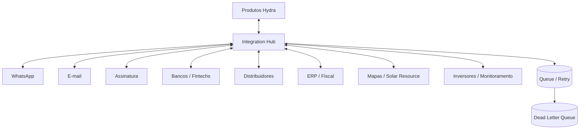

Princípios:

- adaptadores isolados;
- retry;
- timeout;
- idempotência;
- fallback manual;
- cache quando seguro;
- logs;
- health status por integração.

---

# PARTE XVII — ARQUITETURA TÉCNICA

## 58. Estratégia recomendada

O fato de existirem quatro sistemas não obriga começar com dezenas de microserviços.

Recomendação:

- cada produto como aplicação/deploy independente;
- cada produto pode começar internamente como **modular monolith**;
- contratos REST/eventos estáveis entre produtos;
- serviços compartilhados realmente transversais separados;
- evolução para microserviços somente onde escala, independência ou isolamento justificarem.

---

## 59. Arquitetura lógica

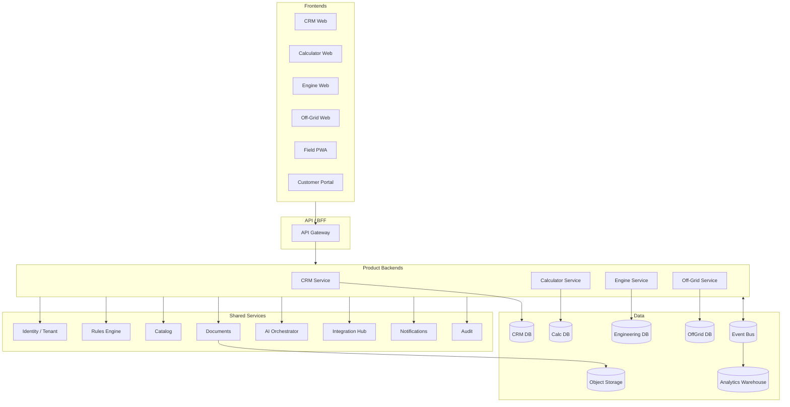

---

## 60. Multi-tenancy

Cada empresa cliente é um `Tenant`.

Requisitos:

- isolamento lógico;
- `tenant_id` em dados de negócio;
- RBAC;
- políticas por tenant;
- feature flags;
- limites por plano;
- auditoria;
- possibilidade futura de isolamento físico para Enterprise.

---

# PARTE XVIII — SEGURANÇA E LGPD

## 61. Requisitos mínimos

- TLS;
- criptografia em repouso;
- gestão segura de secrets;
- MFA;
- RBAC;
- logs de acesso;
- audit log imutável para ações críticas;
- backups;
- política de retenção;
- exportação de dados;
- exclusão quando aplicável;
- minimização de dados;
- segregação por tenant;
- rate limiting;
- monitoramento de incidentes.

## 62. Dados sensíveis operacionalmente

- documentos pessoais;
- conta de energia;
- endereço;
- dados bancários/financeiros;
- contratos;
- conversas;
- fotos do imóvel;
- geolocalização;
- dados de consumo.

---

# PARTE XIX — ROADMAP

## 63. Fase 0 — Descoberta

Antes de congelar o produto:

- entrevistar 10–15 integradores;
- mapear processos reais;
- coletar exemplos anonimizados de contas;
- coletar propostas;
- mapear concessionárias prioritárias;
- mapear fornecedores;
- escolher ICP;
- identificar 5 clientes piloto.

---

## 64. MVP 1 — CRM + Solar Calculator

### CRM

- tenant/usuários;
- leads;
- contas/contatos;
- oportunidades;
- pipeline;
- tarefas;
- WhatsApp;
- OCR;
- documentos;
- proposta;
- margem;
- contrato;
- projeto básico;
- homologação básica.

### Calculator

- consumo;
- recurso solar;
- dimensionamento básico;
- geração;
- economia;
- payback;
- snapshot;
- semáforo.

Objetivo: vendedor conseguir sair de **lead + fatura para proposta preliminar** rapidamente.

---

## 65. MVP 2 — Solar Engine Studio

- catálogo técnico;
- módulos;
- inversores;
- strings;
- MPPT;
- compatibilidade;
- orientação/inclinação;
- layout básico;
- simulação de geração;
- proteções básicas;
- rule engine;
- relatório;
- aprovação técnica;
- snapshot CRM.

---

## 66. MVP 3 — Off-Grid Designer

- cargas;
- perfil de carga;
- autonomia;
- PV array;
- bateria;
- inversor;
- controlador;
- gerador;
- cenários;
- CAPEX/OPEX;
- relatório;
- snapshot CRM.

---

## 67. Fase 4 — Execução e lifecycle

- field service;
- app/PWA offline;
- instalação;
- comissionamento;
- portal do cliente;
- garantias;
- O&M;
- integrações de monitoramento;
- cobrança recorrente.

---

## 68. Fase 5 — Inteligência e ecossistema

- Procurement Optimizer;
- benchmark anonimizável;
- AI Workflow Operator avançado;
- previsão de conversão;
- previsão de atraso;
- manutenção preditiva por integrações;
- embedded finance com múltiplos parceiros;
- BESS avançado;
- gestão de carregadores.

---

# PARTE XX — O QUE NÃO DEVE ENTRAR NO PRIMEIRO MVP

## 69. Escopo a evitar inicialmente

- ERP fiscal completo;
- emissão fiscal própria complexa;
- estoque/warehouse completo;
- telemetria nativa de centenas de fabricantes;
- marketplace próprio;
- carteira própria de crédito;
- roteirização avançada;
- CAD/3D equivalente a software de engenharia maduro;
- simulação física extremamente avançada sem validação;
- app nativo separado para todas as personas.

Integre antes de construir.

---

# PARTE XXI — CRITÉRIOS DE SUCESSO

## 70. Métricas do CRM

- tempo até primeiro valor;
- primeira proposta válida;
- conversão;
- ciclo de venda;
- negócios sem próxima tarefa;
- margem protegida;
- retrabalho;
- atraso de homologação;
- implantação concluída.

## 71. Métricas do Calculator

- tempo de cálculo;
- taxa de conclusão;
- correções manuais;
- % encaminhado ao Engine;
- diferença entre estimativa inicial e projeto final.

## 72. Métricas do Engine

- tempo de projeto;
- quantidade de revisões;
- incompatibilidades detectadas antes da obra;
- erros técnicos pós-aprovação;
- taxa de reutilização do catálogo;
- aprovação na primeira submissão.

## 73. Métricas do Off-Grid

- tempo de dimensionamento;
- cenários comparados;
- diferença entre consumo previsto e real;
- autonomia observada vs projetada;
- taxa de revisão.

---

# PARTE XXII — RISCOS

## 74. Matriz de risco

| Risco | Impacto | Mitigação |
|---|---|---|
| Escopo amplo demais | atraso e baixa qualidade | produtos separados + fases |
| Cálculo técnico incorreto | alto dano | motor determinístico + testes + revisão técnica |
| Regra desatualizada | proposta/projeto errado | Rules Engine versionado |
| IA alucinar | ação indevida | human-in-the-loop |
| API externa quebrar | operação parada | Integration Hub + fallback |
| Usuário abandonar CRM | churn | automação + UX + time-to-value |
| Dados duplicados entre sistemas | inconsistência | Source of Truth + eventos + IDs globais |
| Equipamento com datasheet errado | cálculo inválido | governança de catálogo |
| Copiar concorrentes sem diferenciação | commodity | foco em compliance + margem + engenharia conectada |
| Tentar competir com software de engenharia completo cedo demais | custo excessivo | atacar validação/integração antes de CAD avançado |

---

# PARTE XXIII — FLUXO END-TO-END COMPLETO

## 75. Jornada da empresa integradora

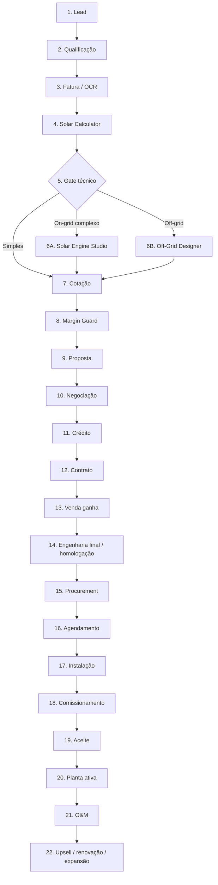

---

# PARTE XXIV — RECOMENDAÇÃO DE IMPLEMENTAÇÃO

## 76. Ordem recomendada

### Primeiro

**CRM Solar + Solar Calculator.**

Motivo: cria o fluxo comercial e gera dados reais rapidamente.

### Segundo

**Solar Engine Studio básico.**

Motivo: começa a criar o principal ativo técnico do ecossistema: catálogo, regras, configurações e histórico de projetos.

### Terceiro

**Off-Grid Designer.**

Motivo: amplia a atuação para armazenamento, sistemas híbridos, rural, telecom, bombeamento e clientes onde a conta de energia tradicional não é suficiente para dimensionar.

### Quarto

**Field + Comissionamento + O&M.**

Motivo: fecha o Project Digital Thread e gera receita recorrente.

---

## 77. Arquitetura de produto recomendada

**Classificação: APROVADA COM RESSALVAS.**

A arquitetura de quatro sistemas é mais defensável do que colocar toda a engenharia dentro do CRM. Porém, a independência técnica não deve se transformar em fragmentação de experiência.

O cliente deve perceber **uma suíte**, mesmo que existam quatro produtos por trás.

Requisitos para isso:

- SSO único;
- tenant único;
- identidade visual única;
- Project ID global;
- navegação cruzada;
- dados principais sem recadastro;
- snapshots imutáveis;
- eventos de domínio;
- catálogo compartilhado;
- Rules Engine compartilhado;
- cobrança unificada, mesmo quando os módulos forem vendidos separadamente.

---

# PARTE XXV — VISÃO FINAL DA SUÍTE

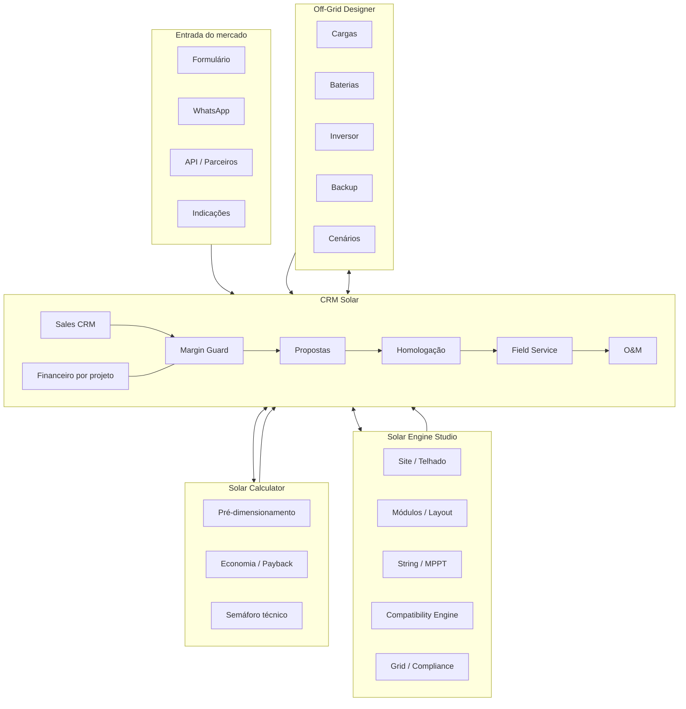

---

# PARTE XXVI — BACKLOG DE ÉPICOS

## 78. CRM

- EPIC-CRM-001 Tenant e usuários
- EPIC-CRM-002 Leads e contatos
- EPIC-CRM-003 Pipeline
- EPIC-CRM-004 WhatsApp
- EPIC-CRM-005 OCR de faturas
- EPIC-CRM-006 Cotação
- EPIC-CRM-007 Margin Guard
- EPIC-CRM-008 Propostas
- EPIC-CRM-009 Contratos
- EPIC-CRM-010 Financiamento
- EPIC-CRM-011 Homologação
- EPIC-CRM-012 Field Service
- EPIC-CRM-013 Comissionamento
- EPIC-CRM-014 O&M
- EPIC-CRM-015 Financeiro de projeto
- EPIC-CRM-016 Portal do cliente

## 79. Solar Calculator

- EPIC-CALC-001 Intake de consumo
- EPIC-CALC-002 Recurso solar
- EPIC-CALC-003 Potência e módulos
- EPIC-CALC-004 Geração
- EPIC-CALC-005 Economia
- EPIC-CALC-006 Payback
- EPIC-CALC-007 Semáforo
- EPIC-CALC-008 Snapshot

## 80. Solar Engine Studio

- EPIC-ENG-001 Projetos e versões
- EPIC-ENG-002 Catálogo de módulos
- EPIC-ENG-003 Catálogo de inversores
- EPIC-ENG-004 Superfícies
- EPIC-ENG-005 Layout
- EPIC-ENG-006 Strings e MPPT
- EPIC-ENG-007 Compatibility Engine
- EPIC-ENG-008 Proteções
- EPIC-ENG-009 Cabos
- EPIC-ENG-010 Simulação energética
- EPIC-ENG-011 Grid/Connection Feasibility
- EPIC-ENG-012 Compliance
- EPIC-ENG-013 Relatórios

## 81. Off-Grid Designer

- EPIC-OFF-001 Cadastro de cargas
- EPIC-OFF-002 Perfil de carga
- EPIC-OFF-003 Recurso solar
- EPIC-OFF-004 Autonomia
- EPIC-OFF-005 Banco de baterias
- EPIC-OFF-006 Inversor
- EPIC-OFF-007 Controlador
- EPIC-OFF-008 Gerador
- EPIC-OFF-009 Cenários
- EPIC-OFF-010 Relatórios

## 82. Plataforma compartilhada

- EPIC-PLAT-001 IAM/SSO
- EPIC-PLAT-002 Multi-tenancy
- EPIC-PLAT-003 Rules Engine
- EPIC-PLAT-004 Catálogo técnico
- EPIC-PLAT-005 Document Service
- EPIC-PLAT-006 Integration Hub
- EPIC-PLAT-007 Event Bus
- EPIC-PLAT-008 Audit Log
- EPIC-PLAT-009 AI Orchestrator
- EPIC-PLAT-010 Analytics

---

# PARTE XXVII — DEFINIÇÃO DE PRONTO PARA FUNÇÕES TÉCNICAS

## 83. Cálculo técnico

Um cálculo só pode ser considerado pronto quando possuir:

- inputs persistidos;
- unidade de medida explícita;
- validação de faixa;
- versão do algoritmo;
- testes automatizados;
- tolerâncias documentadas;
- premissas visíveis;
- snapshot;
- comparação com casos conhecidos;
- revisão por especialista antes da liberação produtiva.

## 84. Regra regulatória

Uma regra só pode ser considerada pronta quando possuir:

- fonte;
- vigência;
- versão;
- escopo;
- testes;
- responsável pela revisão;
- processo de atualização;
- histórico;
- impacto em projetos existentes.

---

# PARTE XXVIII — CONCLUSÃO

A oportunidade mais forte não está em construir um CRM maior do que todos os concorrentes. Está em construir **uma suíte conectada que transforma dados comerciais em decisões técnicas e, posteriormente, em execução operacional auditável**.

O CRM deve ser a camada de relacionamento e operação. O Solar Calculator deve entregar velocidade. O Solar Engine Studio deve entregar profundidade técnica e confiança. O Off-Grid Designer deve resolver um domínio especializado que a lógica tradicional de conta de energia não cobre adequadamente.

A combinação cria uma arquitetura com quatro portas de entrada comerciais:

1. empresa quer apenas CRM;
2. vendedor quer apenas cálculo rápido;
3. projetista quer engenharia;
4. especialista rural/off-grid quer dimensionamento autônomo.

Depois, a Hydra Labs pode converter esses usuários para a suíte completa.

A vantagem defensável tende a vir menos da quantidade de telas e mais de cinco ativos acumulativos:

1. **base técnica de equipamentos**;
2. **motor versionado de regras**;
3. **histórico de projetos e decisões**;
4. **dados reais de margem, execução e performance**;
5. **integração contínua entre comercial e engenharia sem redigitação**.

Esses cinco ativos devem orientar as decisões de arquitetura, produto e roadmap.

---

## Referências-base do documento

- Relatório de inteligência de mercado produzido anteriormente para a Hydra Labs: análise de Azume, SolarMarket, SolarZ, Luvik, Groner, 77Sol, Solfácil, Solaris Control, Solaryum e Solarfy.
- **Energia Fotovoltaica: volume 3** — José Soares Batista Lopes. Florianópolis: ENBPar/IFSC, 2023. Projeto EnergIF.
- O material técnico foi utilizado como referência de conceitos e processos. Regras regulatórias e normativas devem ser verificadas em fontes oficiais atuais antes de implementação produtiva.
