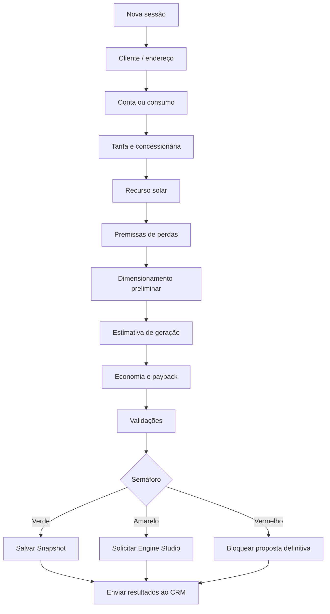

# Fluxo do Solar Calculator

Sessão de cálculo rápido, do cliente/endereço até o snapshot e o envio ao CRM. O semáforo decide se a proposta segue, vai para engenharia ou é bloqueada.

> Fonte: [modelagem completa](../00-visao-geral/modelagem-completa.md), seção 15.
