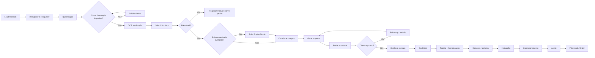

# Fluxo principal do CRM

Do recebimento do lead até o pós-venda/O&M, passando pelo Solar Calculator, pela engenharia (quando necessária), cotação com margem, proposta, contrato e projeto.

> Fonte: [modelagem completa](../00-visao-geral/modelagem-completa.md), seção 9.
