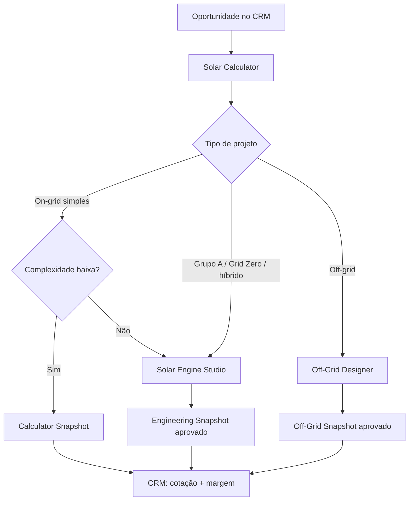

# Fluxo de decisão técnica

Define qual sistema é acionado a partir de uma oportunidade: Calculator (simples), Engine Studio (Grupo A, Grid Zero, híbrido, on-grid complexo) ou Off-Grid Designer.

> Fonte: [modelagem completa](../00-visao-geral/modelagem-completa.md), seção 30.
