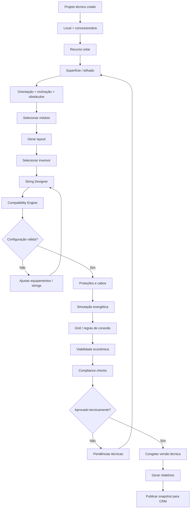

# Fluxo do Solar Engine Studio

Do projeto técnico até a publicação do snapshot de engenharia aprovado para o CRM.

> Fonte: [modelagem completa](../00-visao-geral/modelagem-completa.md), seção 18.
