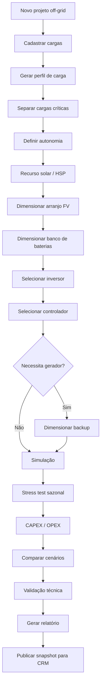

# Fluxo do Off-Grid Designer

Começa pela carga (e não pela conta de energia) e termina no snapshot off-grid publicado para o CRM.

> Fonte: [modelagem completa](../00-visao-geral/modelagem-completa.md), seção 29.
