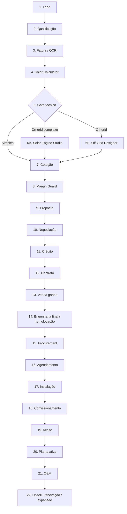

# Jornada ponta a ponta da integradora

Os 22 passos do Project Digital Thread: lead → oportunidade → cálculo → engenharia → cotação → proposta → contrato → homologação → instalação → comissionamento → O&M.

> Fonte: [modelagem completa](../00-visao-geral/modelagem-completa.md), seção 75.
