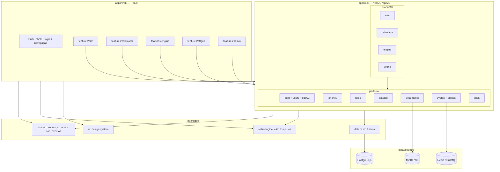
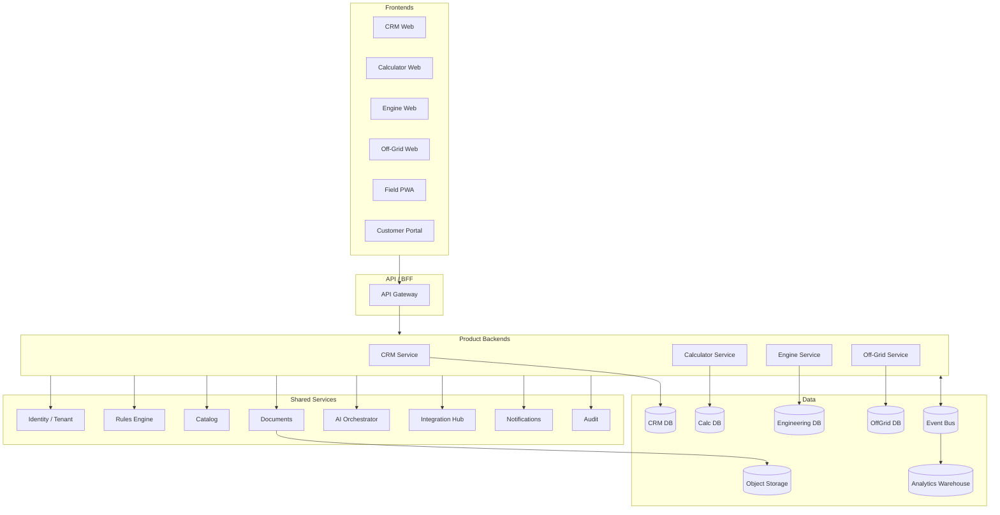

# Arquitetura lógica

A modelagem original (seção 59) descreve quatro backends e serviços compartilhados. Na implementação, seguimos a recomendação da seção 58: **modular monolith** — uma única API NestJS, com um módulo por produto e módulos de plataforma, separados por fronteiras explícitas e prontos para extração futura. Veja [ADR-0002](../04-arquitetura/adr/0002-modular-monolith.md).

## Visão implementada

## Regras de dependência

- `apps/*` dependem de `packages/*`; `packages/*` nunca dependem de `apps/*`.
- `@voltex/shared` e `@voltex/solar-engine` **não** dependem de Nest, React nem Prisma.
- Somente `apps/api` importa `@voltex/database` (Prisma). O front usa tipos/enums de `@voltex/shared`.
- Módulos de `products/*` não importam uns aos outros diretamente: a comunicação é por **eventos de domínio** ou por **contratos públicos** (serviços exportados explicitamente).
- Módulos de `products/*` podem usar `platform/*`; o inverso não é permitido.

## Visão original (modelagem)

Para referência, a arquitetura-alvo completa com serviços independentes:

