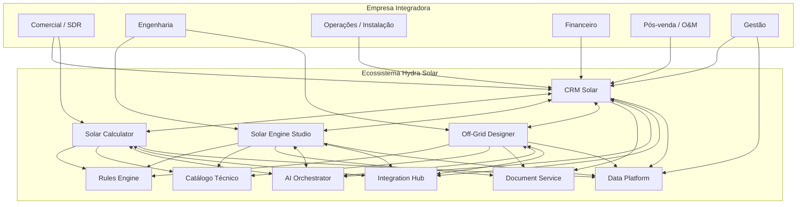

# Diagrama de contexto do ecossistema

Visão de contexto (C4 nível 1): quem usa a suíte, os quatro produtos e os serviços compartilhados.

> Fonte: [modelagem completa](../00-visao-geral/modelagem-completa.md), seção 4.
