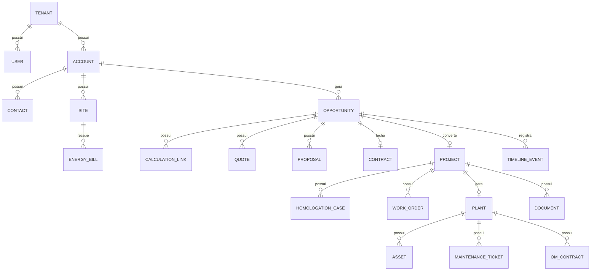

# Modelo de entidades do CRM

Entidades principais do CRM Solar (conceitual). O modelo físico real fica em `packages/database/prisma/schema` e será exportado para cá (Fase 3).

> Fonte: [modelagem completa](../../00-visao-geral/modelagem-completa.md), seção 34.
