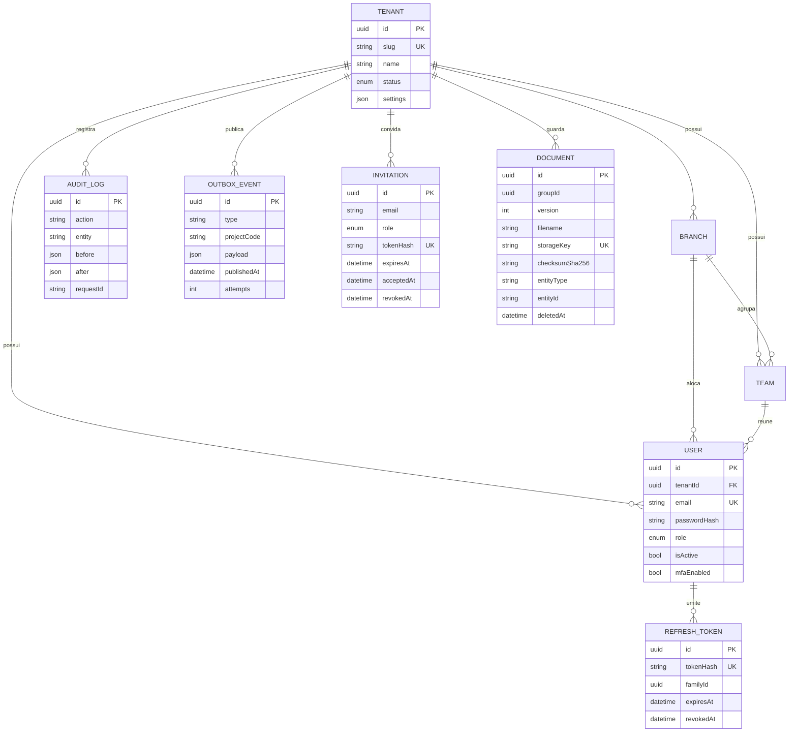

# Modelo de entidades da plataforma

Modelo **físico** atual (`packages/database/prisma/schema/platform.prisma`). Todos os modelos, exceto `Tenant`, carregam `tenantId` ([ADR-0005](../../04-arquitetura/adr/0005-multi-tenancy.md)).

- `AUDIT_LOG` é imutável (trigger no banco).
- `INVITATION` guarda só o hash do token; o convite expira, pode ser revogado e só é usado uma vez.
- `DOCUMENT` é versionado por `groupId` + `version`; o vínculo (`entityType`/`entityId`) é polimórfico (lead, oportunidade, projeto...).
- `OUTBOX_EVENT` é gravado na mesma transação do dado de negócio e entregue por um worker ([eventos](../../04-arquitetura/eventos.md)).
- `REFRESH_TOKEN` guarda só o hash; `familyId` permite revogar a cadeia inteira se um token já usado reaparecer.
