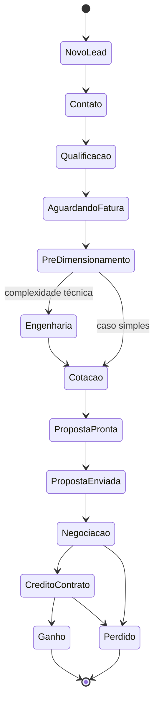

# Máquina de estados da oportunidade

Transições permitidas entre as etapas do pipeline padrão. A mesma máquina será implementada em `@voltex/shared` e validada na API. O pipeline é personalizável por tenant, mas as transições devem respeitar esta base.

> Fonte: [modelagem completa](../../00-visao-geral/modelagem-completa.md), seção 10.
