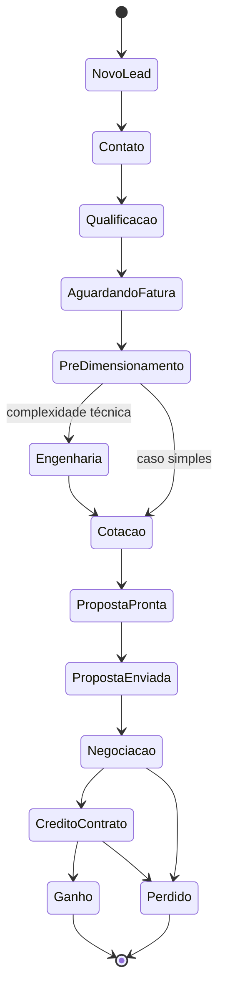

# Máquina de estados da oportunidade

Transições permitidas entre as etapas do pipeline padrão. A mesma máquina será implementada em `@voltex/shared` e validada na API. O pipeline é personalizável por tenant, mas as transições devem respeitar esta base.

## Transições implementadas

Definidas em `OPPORTUNITY_TRANSITIONS` (`@voltex/shared`) e validadas na API e no navegador. O diagrama acima mostra o caminho principal; na prática, cada etapa também permite **recuar** para refazer um passo e ir a **Perdido**.

| De                        | Para                                                                   |
| ------------------------- | ---------------------------------------------------------------------- |
| Novo lead                 | Primeiro contato · Qualificação · Perdido                              |
| Primeiro contato          | Qualificação · Perdido                                                 |
| Qualificação              | Fatura pendente · Pré-dimensionamento · Primeiro contato · Perdido     |
| Fatura pendente           | Pré-dimensionamento · Qualificação · Perdido                           |
| Pré-dimensionamento       | Visita técnica · Engenharia · Cotação · Fatura pendente · Perdido      |
| Visita técnica necessária | Pré-dimensionamento · Engenharia · Cotação · Perdido                   |
| Engenharia necessária     | Cotação · Pré-dimensionamento · Perdido                                |
| Cotação                   | Proposta pronta · Pré-dimensionamento · Engenharia · Perdido           |
| Proposta pronta           | Proposta enviada · Cotação · Perdido                                   |
| Proposta enviada          | Negociação · Crédito/financiamento · Contrato · Cotação · Perdido      |
| Negociação                | Crédito/financiamento · Contrato · Cotação · Proposta pronta · Perdido |
| Crédito/financiamento     | Contrato · Negociação · Perdido                                        |
| Contrato                  | **Ganho** · Crédito/financiamento · Negociação · Perdido               |
| Ganho                     | — (final)                                                              |
| Perdido                   | Primeiro contato · Qualificação (reabrir)                              |

Regras: Perdido exige o motivo (também no banco); Ganho só nasce do contrato assinado, nunca por mover manualmente; as travas da triagem e da margem entram antes de "Proposta pronta" (Fase 7B).

> Fonte: [modelagem completa](../../00-visao-geral/modelagem-completa.md), seção 10.
