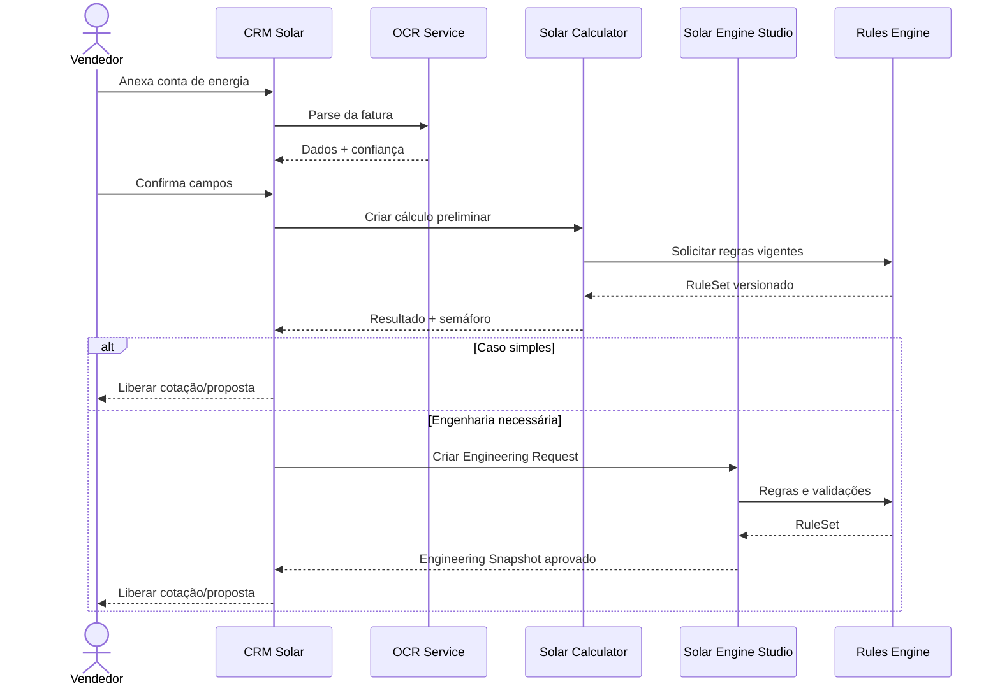

# Sequência CRM → Calculator → Engine

Interação entre vendedor, CRM, OCR, Calculator, Engine Studio e Rules Engine, com os dois caminhos (caso simples e engenharia necessária).

> Fonte: [modelagem completa](../../00-visao-geral/modelagem-completa.md), seção 31.
