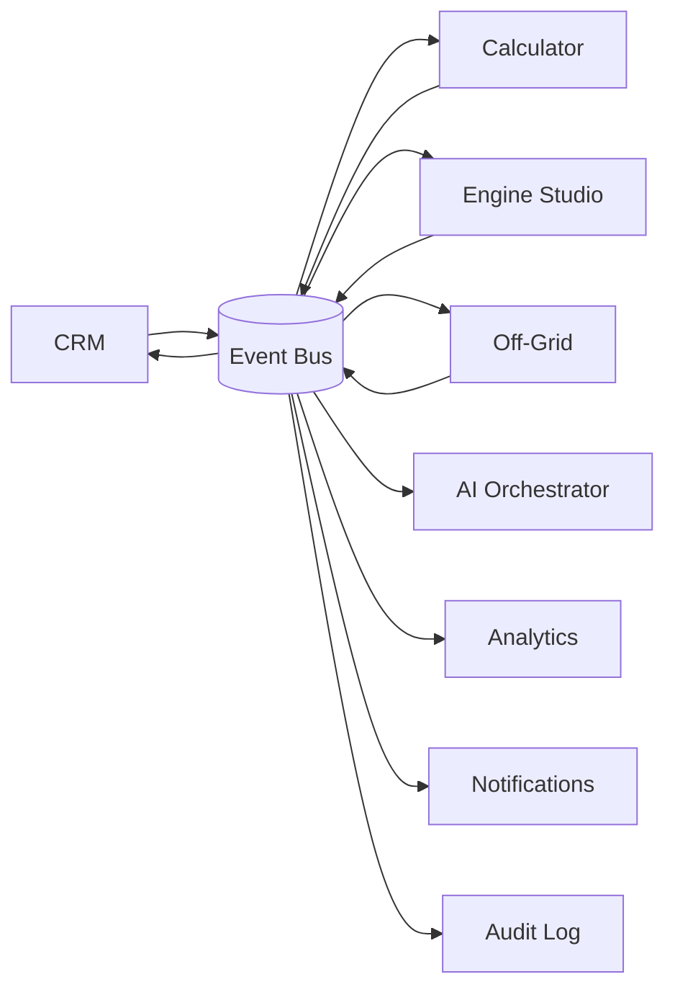

# Catálogo de eventos de domínio

Eventos publicados pelos módulos (seção 37 da modelagem). Os nomes e payloads serão definidos como schemas Zod em `@voltex/shared/events` e serão a única forma de comunicação assíncrona entre módulos de produto.

## Convenções

- Nome em PascalCase, no passado (`OpportunityStageChanged`).
- Envelope comum: `id`, `type`, `occurredAt`, `tenantId`, `actorId`, `projectCode` (quando houver), `payload`, `schemaVersion`.
- Publicação via **outbox transacional**: o evento é gravado na mesma transação do dado de negócio e um worker o entrega aos consumidores (entrega _at-least-once_; consumidores devem ser idempotentes).
- Eventos são imutáveis e versionados (`schemaVersion`).

## Plataforma

`UserInvited` · `UserActivated` · `DocumentUploaded`

## Project Guard (planejados, Fase 7B)

`ProjectGuardEvaluated` · `ProjectGuardOverridden`

## Comercial

`LeadCreated` · `LeadQualified` · `EnergyBillRequested` · `EnergyBillParsed` · `EnergyBillValidated` · `OpportunityCreated` · `OpportunityStageChanged`

## Cálculos

`QuickCalculationCompleted` já é publicado (Fase 6): payload com `sessionId`, `trafficLight`, `requiresEngineering`, `installedPowerKwp`, `algorithmVersion` e `ruleSetRef`, gravado no outbox na mesma transação da sessão de cálculo.

`QuickCalculationRequested` · `QuickCalculationCompleted` · `EngineeringRequested` · `EngineeringVersionApproved` · `OffGridDesignRequested` · `OffGridScenarioApproved`

## Venda

`QuoteCreated` · `MarginThresholdViolated` · `ProposalGenerated` · `ProposalViewed` · `ProposalAccepted` · `ContractSigned` · `DealWon`

## Execução

`HomologationStarted` · `HomologationPending` · `HomologationApproved` · `MaterialsReady` · `InstallationScheduled` · `InstallationCompleted` · `CommissioningCompleted` · `CustomerAccepted`

## Lifecycle

`PlantActivated` · `MonitoringAlertReceived` · `MaintenanceTicketCreated` · `WarrantyExpiring` · `OMRenewalDue` · `UpsellOpportunityDetected`

## Topologia

Na modelagem, os produtos publicam e consomem de um event bus central, que também alimenta IA, analytics, notificações e auditoria:

No modular monolith, o "bus" é o módulo `platform/events` (EventEmitter + outbox + BullMQ). A evolução para um broker externo não deve exigir mudança nos contratos.
