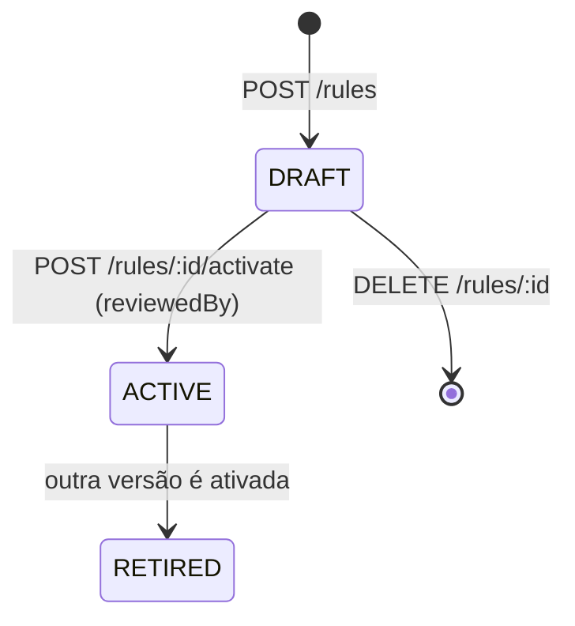

# Rules Engine (base)

Parâmetros que mudam o resultado de um cálculo (limites, PR padrão, custo de disponibilidade, classes de geração) **não são constantes do código**: são dados versionados, com fonte, vigência e responsável pela revisão (RN-012). A Fase 6 entrega a **base** desse motor; o avaliador de condições e as regras por concessionária entram quando houver fonte oficial.

## Modelo

`RuleSet` (por empresa, chave `calculator.rules`):

| Campo                       | Significado                                                                                 |
| --------------------------- | ------------------------------------------------------------------------------------------- |
| `version`                   | Inteira, crescente por empresa e chave                                                      |
| `status`                    | `DRAFT` → `ACTIVE` → `RETIRED`                                                              |
| `definition`                | JSON: `thresholds` (parcial) e `availabilityCostKwh` (por mono/bi/trifásico)                |
| `sources`                   | Ao menos uma: tipo (`REGULATION`, `STANDARD`, `BOOK`, `INTERNAL_POLICY`), referência e link |
| `reviewedBy` / `reviewedAt` | Obrigatórios para ativar                                                                    |
| `validFrom` / `validTo`     | Vigência; ativar define o início e aposenta a versão anterior                               |

## Ciclo de vida

- **Imutável depois de ativada.** Um gatilho no banco bloqueia qualquer alteração de `definition`, fontes e revisão, e a exclusão. Para mudar, crie uma nova versão.
- **Uma ativa por chave e empresa**, garantido por índice parcial único no banco (não só pela aplicação).
- Rascunho pode ser excluído; ativar exige `reviewedBy` (3+ caracteres) e vale só para rascunho.

## Qual regra vale

`GET /rules/effective` e `GET /calculations/quick/config` devolvem a regra em vigor:

1. versão `ACTIVE` da empresa dentro da vigência (a de maior versão);
2. senão, o **padrão do produto** (`builtin@1`), com as fontes do EnergIF e as hipóteses declaradas.

Ao criar a versão, os valores que ela não define são preenchidos com os padrões de `thresholdsSchema` **e gravados junto**: a versão fica autocontida e reproduzível, mesmo que o padrão do produto mude depois. O **custo de disponibilidade não tem padrão**: depende da regulação vigente, então só existe se a empresa o cadastrar; sem ele, o usuário informa o valor da fatura em cada cálculo.

A referência gravada em cada cálculo e snapshot é `builtin@1` ou `<id>@<versão>`: dá para saber exatamente qual regra gerou um número.

## Dados de referência (por empresa)

| Dado           | Regras                                                                                               |
| -------------- | ---------------------------------------------------------------------------------------------------- |
| Concessionária | Nome único por empresa; não exclui com tarifas                                                       |
| Tarifa         | R$/kWh em centavos (admite fração), grupo A/B, **vigência** e **fonte obrigatória**; exclusão lógica |
| Irradiação     | HSP mensal (12 valores) por local, **fonte obrigatória**; mesmo nome+UF atualiza; importação CSV     |

Leitura: `calculator.session.read`. Escrita: `platform.rule.manage`. **O sistema não traz HSP, tarifas nem custo de disponibilidade prontos:** nenhum número sem fonte é embutido (ver [fontes oficiais](../referencias/fontes-oficiais.md)).

## Rastreabilidade no cálculo

O servidor busca o local e a tarifa escolhidos **no banco** (não confia no cliente), grava o que foi usado (nome, fonte, vigência) e marca `overridden` quando o usuário alterou o valor do cadastro. Snapshots guardam tudo isso e nunca mudam: alterar tarifa ou ativar outra regra depois **não** altera snapshots antigos (coberto por teste e2e).

## Fora desta fase

Avaliador de condições (YAML da seção 41 da modelagem), regras por concessionária/estado, aprovação em duas etapas e criação/ativação de regras pela interface (hoje é pela API; a tela mostra a regra em vigor e as versões).
