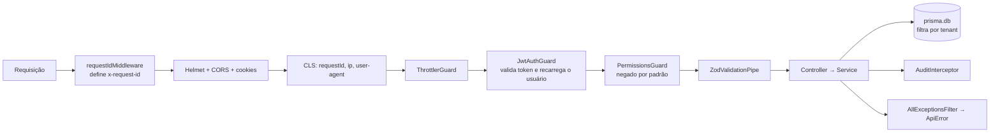

# API (NestJS)

`apps/api` — modular monolith ([ADR-0002](../04-arquitetura/adr/0002-modular-monolith.md)). Contratos e convenções de rota: [API](../05-api/README.md). Swagger interativo em `http://localhost:3000/api/docs` (JSON em `/api/docs-json`).

> A API usa **NestJS 11**. O Nest 12 já é a versão mais recente, mas `nestjs-zod` (validação com os schemas de `@voltex/shared`) ainda não o suporta; a migração será avaliada quando houver suporte.

## Estrutura

```
apps/api/src/
├── main.ts · setup.ts · app.module.ts   # bootstrap, configuração HTTP compartilhada com os testes, módulo raiz
├── config/env.ts                        # variáveis de ambiente validadas por Zod (falha no boot)
├── common/                              # contexto da requisição, decorators, filtro de erros, paginação, redact
└── platform/                            # serviços transversais
    ├── prisma/      # PrismaService: `db` (escopado por tenant) e `system`
    ├── auth/        # login, refresh rotativo, logout, guards globais, cookie de sessão
    ├── tenancy/     # empresa, filiais, times
    ├── users/       # usuários, convites, política de perfis
    ├── audit/       # trilha de auditoria
    ├── events/      # event bus (outbox transacional) e publicador
    ├── documents/   # upload/download no S3, versões
    ├── mail/        # envio de e-mail (SMTP/Mailpit)
    └── health/      # /health: banco, Redis e armazenamento
```

Os módulos de produto (`products/crm`, `products/calculator`, ...) entram nas Fases 6 e 7 e só dependem de `platform/*`.

## Como uma requisição é processada



## Autenticação e sessão ([ADR-0011](../04-arquitetura/adr/0011-sessao-jwt-e-refresh-rotativo.md))

- `POST /auth/login` → `accessToken` (JWT, 15 min) no corpo e **refresh token opaco em cookie `httpOnly`** (`voltex_refresh`, `SameSite=Lax`, `Path=/api/v1/auth`, `Secure` em produção). O refresh token **nunca** vai no corpo JSON.
- `POST /auth/refresh` rotaciona o refresh token a cada uso. Reapresentar um token já usado (fora de uma janela de tolerância de 10 s para abas simultâneas) é tratado como roubo: **toda a família de sessões é revogada** e o evento é auditado.
- `POST /auth/logout` revoga a sessão e é idempotente.
- A cada requisição o `JwtAuthGuard` recarrega usuário e tenant do banco: desativar um usuário, suspender um tenant ou mudar um perfil vale **imediatamente**.
- Login responde igual para e-mail inexistente e senha errada (e verifica a senha nos dois casos) para impedir enumeração de usuários. Limite: 5 tentativas/min por IP.

## Autorização: negado por padrão

Toda rota precisa declarar uma destas marcas; sem nenhuma, o `PermissionsGuard` responde **403** e registra o erro no log:

| Decorator                                   | Significado                                                                  |
| ------------------------------------------- | ---------------------------------------------------------------------------- |
| `@Public()`                                 | Sem token (login, refresh, logout, health, aceitar convite)                  |
| `@Authenticated()`                          | Qualquer usuário autenticado (ex.: `GET /auth/me`)                           |
| `@RequirePermissions('crm.lead.read', ...)` | Exige **todas** as permissões; vêm de `ROLE_PERMISSIONS` em `@voltex/shared` |

Gestão de usuários ([política de perfis](../04-arquitetura/adr/0012-acesso-a-dados-por-tenant.md#política-de-perfis)): OWNER gerencia todos; ADMIN gerencia todos, menos OWNER; ninguém altera o próprio perfil nem se desativa; o tenant sempre mantém um OWNER ativo.

## Acesso a dados e tenant ([ADR-0012](../04-arquitetura/adr/0012-acesso-a-dados-por-tenant.md))

Duas portas, de propósito:

```ts
this.prisma.db; // padrão: filtra por tenant sozinho; SEM tenant no contexto, FALHA
this.prisma.system; // sem filtro: só login, refresh, convite e workers. Quem usa filtra à mão
```

- Em `db`, `tenantId` é injetado em toda leitura/escrita; filtrar por outro tenant, criar em outro tenant ou **mover um registro** para outro tenant lança `TenantScopeError`. Operações desconhecidas também falham (falha fechada).
- O tipo do Prisma exige `tenantId` nos `create`; passe `this.context.requireTenantId()` (a extensão confirma que é o mesmo).
- `$queryRaw`/`$executeRaw` **não** passam pela extensão: evite-os em código de negócio.
- Todo modelo novo com `tenantId` entra em `TENANT_SCOPED_MODELS` (um teste garante).

## Auditoria

- Marque a rota com `@Audit('branch.created', 'Branch')` para registrar a resposta como "depois", ou chame `audit.record({ ..., before, after }, tx)` dentro da transação para auditoria **atômica** com a mudança.
- Cada registro guarda ator, IP, user-agent e `requestId`. Campos como senha, token, secret e hash são mascarados (`redact`).
- A tabela é imutável no banco (trigger). Consulta: `GET /audit-logs` (`platform.audit.read`).

## Eventos (outbox)

```ts
await this.prisma.db.$transaction(async (tx) => {
  const doc = await tx.document.create({ ... });
  await this.events.publish({ type: DomainEvent.DOCUMENT_UPLOADED, payload: { documentId: doc.id } }, tx);
});

@OnEvent('DocumentUploaded', { suppressErrors: false }) // false: falha → registra e reentrega
handle(event: DomainEventEnvelope) { ... }               // deve ser idempotente
```

O evento é gravado na mesma transação do dado. O `OutboxPublisher` varre os pendentes a cada segundo (`FOR UPDATE SKIP LOCKED`, seguro com várias instâncias), entrega a `@OnEvent` e marca como publicado; em falha incrementa `attempts` e guarda `lastError`; após 10 tentativas o evento fica parado para análise. As filas BullMQ chegam com as automações (Fase 7).

## Documentos

`POST /documents` (multipart, campo `file`) valida tipo e **assinatura do conteúdo** (PDF/PNG/JPEG), limite de tamanho (`UPLOAD_MAX_BYTES`), sanitiza o nome e grava no S3 com chave `<tenantId>/<ano>/<mês>/<uuid>-<nome>`. Reenviar com `replacesDocumentId` cria uma nova versão no mesmo grupo. O download é por URL pré-assinada de 5 minutos; a chave interna do objeto nunca é exposta. Exclusão é lógica.

## Testes

| Comando                          | O que roda                                                                                                     |
| -------------------------------- | -------------------------------------------------------------------------------------------------------------- |
| `pnpm --filter @voltex/api test` | Unitários (escopo de tenant, guard de permissões, ambiente, redact, validação de arquivos, política de perfis) |
| `pnpm test:e2e`                  | e2e com a aplicação inteira, **banco `voltex_test` real** e S3 real                                            |

Os e2e exigem a infra no ar (`pnpm infra:up`). O banco de teste é **recriado do zero** a cada execução (schema + migrations) e a suíte recusa rodar em qualquer banco cujo nome não termine em `_test`. Cada arquivo cria seus próprios tenants, então os testes não dependem uns dos outros. Só o envio de e-mail é substituído por um dublê.

Cobertura e2e: autenticação (login, rotação e reuso de refresh, logout, limite de tentativas, tokens forjados), RBAC, **isolamento entre tenants** (usuários, filiais, times, documentos, convites, auditoria, camada de dados), usuários e convites, documentos, outbox, auditoria, cabeçalhos de segurança, CORS e geração do OpenAPI.

## Adicionando um endpoint

1. Schema Zod em `@voltex/shared` (reaproveitado pelo front).
2. DTO: `class XDto extends createZodDto(schema) {}`.
3. Controller com **uma** marca de acesso e, se mutar dados, `@Audit(...)` ou auditoria no service.
4. Service usando `prisma.db` (e `tx` quando houver auditoria/evento).
5. Teste e2e cobrindo sucesso, 401/403 e acesso a dado de outro tenant.
