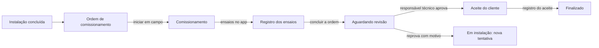

# Comissionamento e aceite do cliente (Fase 11D)

Decisão em [ADR-0022](../04-arquitetura/adr/0022-comissionamento-regra-e-travas.md); cálculo no [memorial](../06-calculos/comissionamento.md). Telas: ficha da instalação (**Comissionamento**, **Aceite do cliente**) e o app de campo (ordem de comissionamento, [guia](campo-offline.md)).

## Do campo à aceitação



1. **Instalação concluída** cria a ordem de comissionamento (11B) e o **registro** do comissionamento (com os ensaios da regra em vigor, ou do modelo-base provisório).
2. **Em campo** o técnico informa as **condições** (irradiância, temperatura do módulo e do ambiente) e registra cada ensaio: conferência (conforme ou não) ou medição (valor). A tela mostra na hora o valor esperado, o desvio e o resultado, com a mesma conta do servidor.
3. **Concluir a ordem** envia o registro para revisão e é **recusado** se faltar ensaio obrigatório.
4. O **responsável técnico** (`ops.commissioning.approve`) aprova ou reprova. Aprovar gera o relatório em PDF, passa a instalação para "aceite do cliente" e cria a tarefa de colher o aceite. Reprovar devolve a instalação a "em instalação" (com tarefa de corrigir) e a nova ordem de comissionamento abre a tentativa seguinte.
5. O **aceite** é registrado pelo escritório (com ou sem a assinatura colhida em campo) e finaliza a instalação.

## Regra `ops.commissioning`

Cadastrada em **Administração → Regras** (importar JSON). Estrutura:

```json
{
  "tests": [
    {
      "code": "STRING_ISC",
      "label": "Isc da string",
      "group": "Categoria 1",
      "kind": "MEASURE",
      "scope": "STRING",
      "unit": "A",
      "expected": "ISC_STRING",
      "tolerancePct": 5,
      "source": "NBR 16274, item X"
    },
    {
      "code": "GROUND_CONTINUITY",
      "label": "Continuidade do aterramento",
      "group": "Categoria 1",
      "kind": "CHECK",
      "source": "NBR 16274, item Y"
    }
  ]
}
```

- Campos: `kind` (`CHECK` | `MEASURE`), `level` (`STANDARD` | `EXTENDED`), `scope` (`SYSTEM` | `STRING` | `INVERTER`), `expected` (`NONE` | `VOC_STRING` | `ISC_STRING`), `tolerancePct`, `min`, `max`, `required`, `source` (**obrigatória**).
- Ativar exige o **revisor e o registro no conselho** (CREA/CFT/CAU). Os valores acima são **ilustrativos**: a tolerância e os limites são do responsável técnico.
- Sem regra ativa vale o **modelo-base provisório** (lista do livro, sem limites): registra, mas não julga e não aprova.

## Travas da aprovação

Regra provisória · ensaio obrigatório sem registro · ensaio reprovado · ensaio "sem regra" ou "sem dado". Com qualquer uma, **Aprovar** é recusado e a tela lista os motivos. Reprovar sempre é possível (com motivo).

## Níveis e strings

- **Padrão** (categoria 1) ou **ampliado** (categorias 1 e 2). O nível só muda antes de qualquer registro.
- As strings vêm do projeto técnico aprovado. Sem ele, o escritório as acrescenta (**Acrescentar strings**) e o esperado não é calculado ("sem dado").

## Aceite do cliente

`POST /operations/installations/:id/acceptance` (nome de quem aceitou, canal `OFFICE` ou `FIELD`, observação, e a ordem cuja assinatura de campo comprova o aceite). Só com o comissionamento aprovado; publica `CustomerAccepted` e finaliza. **É um registro, não uma assinatura eletrônica.** A mudança manual para "aceite do cliente" e para "finalizado" exige as respectivas travas.

## API

| Rota                                               | Permissão                   | Para quê                                                           |
| -------------------------------------------------- | --------------------------- | ------------------------------------------------------------------ |
| `GET /operations/installations/:id/commissioning`  | `ops.commissioning.read`    | Registro atual e tentativas anteriores                             |
| `POST /operations/installations/:id/commissioning` | `ops.commissioning.write`   | Abre (ou nova tentativa após reprovação)                           |
| `PATCH /operations/commissioning/:id`              | `ops.commissioning.write`   | Nível e condições (rejulga as medições)                            |
| `POST /operations/commissioning/:id/strings`       | `ops.commissioning.write`   | Strings informadas à mão                                           |
| `PATCH /operations/commissioning/tests/:testId`    | `ops.commissioning.write`   | Registra um ensaio (valor, conformidade, nota, condições próprias) |
| `POST /operations/commissioning/:id/submit`        | `ops.commissioning.write`   | Envia para revisão                                                 |
| `POST /operations/commissioning/:id/decision`      | `ops.commissioning.approve` | `APPROVE` ou `REJECT` (+ motivo)                                   |
| `GET /operations/commissioning/:id/report`         | `ops.commissioning.read`    | Link do relatório PDF (só aprovado)                                |
| `POST /operations/installations/:id/acceptance`    | `ops.installation.write`    | Registra o aceite                                                  |

Ações do app de campo: `MEASURE` (testId, value ou passed, nota, condições próprias) e `CONDITIONS`, ambas idempotentes.

## Testes

`apps/api/test/commissioning.e2e.test.ts` (18 casos: modelo provisório, regra, esperado por temperatura e irradiância, rejulgamento, nível, strings à mão, envio, aprovação, reprovação e nova tentativa, relatório, aceite, campo, permissões, isolamento, modelo congelado), `packages/solar-engine/src/commissioning/*.test.ts` e `features/operations/commissioning.test.tsx` e `features/field/field.test.tsx`.

## Limites desta fase

- A lista do modelo-base é proposta e precisa de conferência com a norma; o ensaio de Voc é do sistema (não literal do livro).
- Não há leitura de arquivo do instrumento (curva I×V, termografia): o resultado vai como conferência com foto como evidência no app de campo.
- A prévia local e o julgamento do servidor usam a mesma função; a calibração e a validade dos instrumentos ficam por conta do responsável técnico.
- O aceite pelo portal do cliente chega na 11H (mesmo serviço, canal `PORTAL`).
