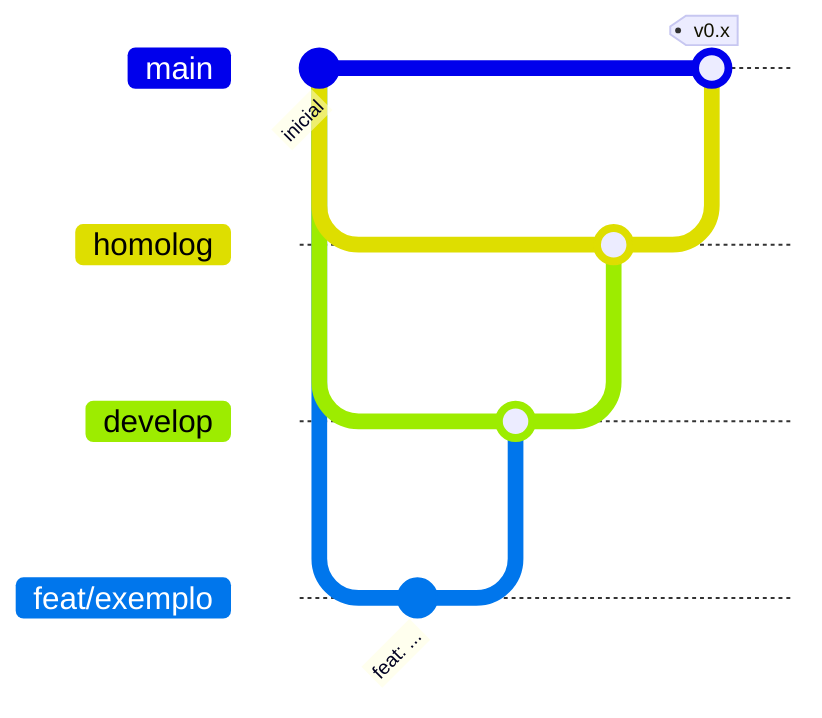

# Fluxo Git

## Branches permanentes

| Branch    | Ambiente        | Recebe de                                                     |
| --------- | --------------- | ------------------------------------------------------------- |
| `develop` | Desenvolvimento | branches de trabalho (`feat/…`, `fix/…`, `docs/…`, `chore/…`) |
| `homolog` | Homologação     | `develop`, via pull request                                   |
| `main`    | Produção        | `homolog`, via pull request                                   |



## Regras

1. Nunca commitar direto em `homolog` ou `main`.
2. Branches de trabalho saem de `develop`, são curtas e usam o prefixo do tipo: `feat/`, `fix/`, `docs/`, `refactor/`, `test/`, `chore/`.
3. Merge em `develop` com `--no-ff` (ou _merge commit_ no pull request) para preservar o contexto da funcionalidade.
4. Promoção `develop → homolog → main` por pull request, com CI verde.
5. Correções urgentes de produção (`hotfix/…`) saem de `main`, voltam para `main` e são trazidas de volta para `homolog` e `develop`.
6. Versões em `main` recebem tag semântica (`v0.1.0`).

## Conventional Commits

Formato: `tipo(escopo opcional): descrição no imperativo, em minúsculas`

| Tipo       | Uso                                 |
| ---------- | ----------------------------------- |
| `feat`     | Nova funcionalidade                 |
| `fix`      | Correção de bug                     |
| `docs`     | Documentação                        |
| `refactor` | Refatoração sem mudar comportamento |
| `perf`     | Melhoria de desempenho              |
| `test`     | Testes                              |
| `build`    | Build, dependências, Docker         |
| `ci`       | Pipelines                           |
| `chore`    | Manutenção e configuração           |
| `revert`   | Reverte um commit                   |

Escopos sugeridos: `api`, `web`, `shared`, `solar-engine`, `database`, `ui`, `docs`, `docker`, `crm`, `calculator`, `engine`, `offgrid`.

Exemplos:

```text
feat(calculator): calcula geração mensal por hsp
fix(api): corrige filtro de tenant em leads
docs: adiciona memorial do solar calculator
chore: atualiza dependências
```

Mudança incompatível: `feat(api)!: ...` ou rodapé `BREAKING CHANGE: ...`.

O hook `commit-msg` (commitlint) rejeita mensagens fora do padrão; o hook `pre-commit` (lint-staged) formata os arquivos com Prettier.
