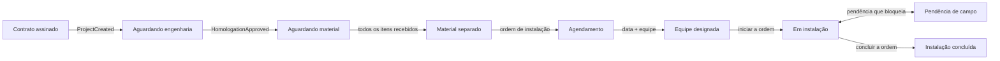

# Operação: instalação, materiais, equipes e agenda (Fase 11B)

Decisão em [ADR-0020](../04-arquitetura/adr/0020-modulo-operacao-e-instalacao.md). Telas em **Operação** (Painel, Instalações, Agenda, Equipes). API em `/operations`.

## Do contrato à instalação

O restante (comissionamento, aceite do cliente, finalizado) está no [diagrama de estados](../03-diagramas/estados/instalacao.md); na 11D ele passa a depender da aprovação do ensaio e do aceite registrado.

## O que acontece sozinho

| Fato                                          | Efeito                                                                                                                                                                  |
| --------------------------------------------- | ----------------------------------------------------------------------------------------------------------------------------------------------------------------------- |
| Contrato assinado (`ProjectCreated`)          | Cria a instalação em "aguardando engenharia"                                                                                                                            |
| Homologação aprovada (`HomologationApproved`) | "Aguardando material", gera a lista de materiais do snapshot técnico (se houver) e cria a tarefa **Comprar o material**                                                 |
| Último item ativo recebido ou separado        | "Material separado", evento `MaterialsReady` e tarefa **Agendar a instalação**                                                                                          |
| Item novo sem recebimento                     | Volta a "aguardando material", com o motivo no histórico                                                                                                                |
| Ordem de instalação criada ou alterada        | "Agendamento" (sem data ou sem equipe) ou "equipe designada" (com data e equipe ou técnico), evento `InstallationScheduled` e tarefa **Avisar o cliente da instalação** |
| Ordem de instalação iniciada                  | "Em instalação"                                                                                                                                                         |
| Pendência de campo que bloqueia               | "Pendência de campo"; ao resolver a última, volta a "em instalação"                                                                                                     |
| Ordem de instalação concluída                 | "Instalação concluída", evento `InstallationCompleted`, ordem de **comissionamento** pendente e tarefa para agendá-la                                                   |

Todas as automações são idempotentes (a tarefa tem chave de automação; a instalação é única por projeto). O histórico marca como "automático" o que o sistema fez.

## Materiais

- **Gerar do projeto técnico:** lê `results.bom.lines` do snapshot aprovado ligado à cotação do contrato. Gera uma vez só; linha inválida (sem quantidade, por exemplo) é ignorada. Sem snapshot, lance os itens à mão.
- **Fluxo do item:** pendente → pedido feito (fornecedor, nº do pedido, valor pago, previsão) → recebido → separado. Dá para receber sem pedido (retirada no balcão). Item separado não cancela. **Pedir** é só um registro: o sistema não compra nada.
- **Comparar ofertas** (RF-CRM-054): para os itens pendentes ou pedidos que têm equipamento do catálogo, lista a oferta **vigente** mais recente de cada fornecedor, da mais barata para a mais cara, com o total para a quantidade. Oferta vencida ou ainda não vigente não entra.

## Equipes, agenda e ordens

- Uma ordem tem **equipe** e/ou **técnico**. Ordens de instalação e de comissionamento exigem a instalação e só nascem no momento certo (material separado; instalação concluída). Só pode haver uma ordem **em aberto** de cada tipo por instalação.
- **Agenda** semanal com filtro por equipe. **Choque de horário** (mesma equipe ou mesmo técnico, horários sobrepostos) aparece como aviso; ordem sem fim presume 4 horas para o cálculo.
- Uma ordem **em execução** não é reagendada nem trocada de equipe; a de instalação em execução também não se cancela (conclua ou registre a pendência).
- **Em campo:** `GET /operations/work-orders/mine` devolve as ordens do técnico (direto ou pela equipe). Iniciar, concluir e registrar pendência só valem para quem está escalado ou para quem gerencia ordens.

## Permissões

| Permissão                       | Quem                                                       | Para quê                                     |
| ------------------------------- | ---------------------------------------------------------- | -------------------------------------------- |
| `ops.installation.read`         | Operação, O&M, Engenharia, Líder técnico, Gestor comercial | Ver instalações, materiais, equipes e painel |
| `ops.installation.write`        | Operação                                                   | Mudar situação, materiais e equipes          |
| `ops.workorder.read` / `.write` | Operação (O&M só lê)                                       | Ver e criar/agendar/cancelar ordens          |
| `ops.field.execute`             | Instalador                                                 | Executar as ordens em que está escalado      |

## Painel (§51)

Instalações por situação, aguardando material, com equipe designada, ordens agendadas **atrasadas** (a data passou e não começaram), pendências abertas, ordens concluídas por equipe nos últimos 30 dias e **retrabalho de campo** (instalações com pendência ou com mais de uma ordem de instalação).

## Testes

`apps/api/test/operations.e2e.test.ts` (27 casos: automações, estados, materiais, equipes, agenda, campo e isolamento), `installation-transitions.test.ts` (máquina de estados) e `features/operations/operations.test.tsx`.

## Limites desta fase

- Sem o app de campo (11C): iniciar e concluir é feito pela API ou por quem gerencia ordens na tela; fotos, geolocalização e modo offline vêm na 11C.
- Comissionamento e aceite do cliente são mudanças manuais de situação até a 11D.
- O aviso ao cliente é uma tarefa; o botão de e-mail e de link do WhatsApp na ficha entra com o portal (11H) e a comunicação (11I).
- A cotação a partir do snapshot só existe para o Engine: projetos do Off-Grid ou de cotação direta têm lista de materiais manual.
- Projetos criados antes da fase ganham instalação por **Criar as que faltam** (Operação → Instalações).
