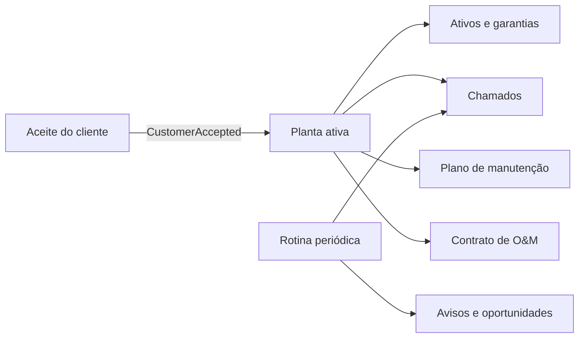

# Pós-venda e O&M (Fase 11E)

Decisão em [ADR-0023](../04-arquitetura/adr/0023-pos-venda-planta-garantia-e-rotina.md). Telas em **Operação**: _Plantas_, _Chamados_, _Garantias_ e _O&M e manutenção_.

## Do aceite à planta

A planta é criada sozinha quando o cliente aceita a instalação, com os ativos da lista de materiais recebida e a geração esperada do projeto técnico aprovado. Para instalações aceitas antes da fase, use **Plantas → Criar as que faltam**.

## O que a empresa precisa configurar

Nada vem pronto. Sem estes cadastros o sistema registra, mas não avisa:

| O quê                                                               | Onde                                 | Efeito se faltar                     |
| ------------------------------------------------------------------- | ------------------------------------ | ------------------------------------ |
| Termo de garantia por fabricante (prazos, % de potência, **fonte**) | Garantias → Novo termo               | Ativo fica “garantia não cadastrada” |
| Janela de aviso de garantia (dias)                                  | O&M e manutenção → Prazos e gatilhos | Nenhum aviso de garantia             |
| Aviso de renovação de O&M (dias)                                    | idem                                 | Nenhum aviso de renovação            |
| Antecedência da manutenção preventiva (dias)                        | idem                                 | O chamado abre no dia do vencimento  |
| Prazo de atendimento por prioridade (horas)                         | idem                                 | Chamado sem SLA                      |
| Gatilho de expansão (kWh/mês e nº de faturas)                       | idem                                 | Nenhuma oportunidade de expansão     |

## Rotina

Roda de hora em hora (`AFTERSALES_SCAN_INTERVAL_MS`, em ms; `0` desliga) ou sob demanda em **O&M e manutenção → Executar a rotina agora**. Cada passo é idempotente:

- plano de manutenção vencido → chamado preventivo e ordem de serviço;
- garantia na janela → tarefa e evento `WarrantyExpiring`;
- contrato de O&M vencido → encerrado (ou renovado, se marcado para renovação automática);
- contrato na janela de renovação → tarefa, evento `OMRenewalDue` e oportunidade no CRM;
- consumo médio da rede acima do gatilho → oportunidade de expansão e evento `UpsellOpportunityDetected`.

## Chamados

Abertos na ficha da planta ou na lista. Resolver exige a descrição da solução. O prazo de atendimento só existe se configurado e **pausa** enquanto o chamado aguarda o cliente. **Gerar ordem de serviço** cria uma ordem de manutenção para agendar na Agenda e executar no app de campo.

## Permissões

`ops.plant.read/write`, `ops.ticket.read/write`, `ops.warranty.manage` (termos e garantias) e `ops.om.manage` (planos, contratos, configurações e rotina). O perfil **OM** reúne todas.

## Pendências do usuário

- Termos de garantia de cada fabricante (PDF) e os prazos oficiais para cadastrar.
- Prazos de aviso, SLA, periodicidade de manutenção e gatilho de expansão da empresa.
