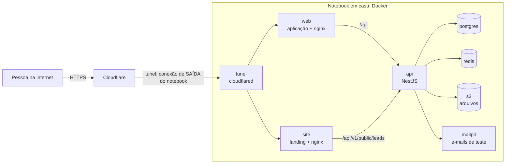

# Deploy tipo 1: servidor de teste em casa (notebook)

Este guia leva o sistema inteiro (site, aplicação, API, banco, filas e arquivos) para **um notebook seu**, ligado na tomada com a tela fechada, funcionando como um servidor. É o **primeiro tipo de deploy** do projeto e custa **zero** (no máximo o registro de um domínio, se você quiser endereços bonitos).

> **Leia isto primeiro.** Este deploy é para **demonstrar e testar com dados fictícios**. Ele não serve para guardar dados reais de clientes: um notebook em casa pode desligar, perder internet, ser roubado ou queimar o disco. Veja [Limites e riscos](#limites-e-riscos). Quando chegar o primeiro cliente de verdade, vamos para outro tipo de deploy (servidor pago ou gerenciado, com backup fora de casa). A composição de produção é a mesma, então a mudança será pequena.

## Sumário

1. [O que você vai ter no final](#o-que-você-vai-ter-no-final)
2. [Como as peças se conectam](#como-as-peças-se-conectam)
3. [Antes de começar](#antes-de-começar)
4. [Passo 1: preparar o notebook (Arch Linux)](#passo-1-preparar-o-notebook-arch-linux)
5. [Passo 2: levar o código para o notebook](#passo-2-levar-o-código-para-o-notebook)
6. [Passo 3: gerar o arquivo de configuração](#passo-3-gerar-o-arquivo-de-configuração)
7. [Passo 4: ligar tudo](#passo-4-ligar-tudo)
8. [Passo 5: criar a primeira empresa e entrar](#passo-5-criar-a-primeira-empresa-e-entrar)
9. [Passo 6: colocar na internet](#passo-6-colocar-na-internet)
10. [Passo 7: ligar o formulário do site ao CRM](#passo-7-ligar-o-formulário-do-site-ao-crm)
11. [Passo 8: ver os e-mails do sistema](#passo-8-ver-os-e-mails-do-sistema)
12. [Passo 9: backups automáticos](#passo-9-backups-automáticos)
13. [Dia a dia](#dia-a-dia)
14. [Solução de problemas](#solução-de-problemas)
15. [Limites e riscos](#limites-e-riscos)
16. [Checklist final](#checklist-final)
17. [Arquivos deste deploy](#arquivos-deste-deploy)

---

## O que você vai ter no final

- O **site de apresentação** (landing page) em um endereço, por exemplo `https://www.suaempresa.com.br`.
- A **aplicação** (login, CRM, calculadora, administração) em outro, por exemplo `https://app.suaempresa.com.br`.
- A **API**, o **banco de dados PostgreSQL**, o **Redis** (filas e automações) e o **armazenamento de arquivos** (contratos, propostas, faturas), todos em contêineres no notebook.
- Uma **caixa de e-mails de teste** (Mailpit) que captura os e-mails do sistema, como os convites de usuário.
- **Backup** diário do banco e dos arquivos.
- Tudo religando sozinho se faltar luz ou o notebook reiniciar.

## Como as peças se conectam



Pontos importantes:

- **Nenhuma porta é aberta no seu roteador.** O notebook liga um túnel de **saída** até a Cloudflare, e o público entra por lá. Isso resolve de uma vez o problema de provedores que não deixam abrir portas (CGNAT, comum no Brasil) e de IP que muda.
- A aplicação e o site **só escutam em `127.0.0.1`** (dentro do próprio notebook). Quem chega de fora é o túnel.
- O banco, o Redis e os arquivos **não têm porta nenhuma** publicada: só os outros contêineres falam com eles.
- Site e aplicação ficam em **endereços diferentes** de propósito (veja o [guia do site](site.md)). O formulário do site chama a API **no próprio endereço do site**, e o nginx do site repassa **só** `/api/v1/public/leads/` para a API.

## Antes de começar

**No notebook**

| Item        | Mínimo                | Recomendado                                       |
| ----------- | --------------------- | ------------------------------------------------- |
| Memória     | 4 GB                  | 8 GB                                              |
| Disco livre | 20 GB                 | 50 GB (imagens Docker, banco, arquivos e backups) |
| Processador | 2 núcleos             | 4 núcleos                                         |
| Rede        | Wi-Fi                 | **Cabo de rede** (mais estável)                   |
| Sistema     | Arch Linux atualizado |                                                   |

A primeira compilação das imagens é a parte pesada (alguns minutos e uns 2 GB de memória). Depois, o conjunto rodando usa algo entre 1,5 e 2 GB.

**Contas e coisas externas**

| Item                                                            | Obrigatório?                                  | Para quê                                         |
| --------------------------------------------------------------- | --------------------------------------------- | ------------------------------------------------ |
| Domínio (ex.: `.com.br`, cerca de R$ 40 por ano no Registro.br) | Só para endereços próprios e túnel permanente | Dois endereços: `www` e `app`                    |
| Conta gratuita na Cloudflare                                    | Só para o túnel permanente                    | Fazer o túnel e o DNS do domínio                 |
| Gerenciador de senhas                                           | **Sim**                                       | Guardar a `DATA_ENCRYPTION_KEY` fora do notebook |
| Outro disco ou pasta na nuvem                                   | Recomendado                                   | Cópia dos backups fora do notebook               |

**Sem domínio?** Dá para usar o sistema mesmo assim: acessando por um túnel SSH a partir do seu computador ([Modo B](#modo-b-acesso-privado-pelo-seu-computador-ssh-sem-domínio-sem-conta)) ou por um endereço temporário ([Modo C](#modo-c-endereço-temporário-sem-conta-e-sem-domínio)).

---

## Passo 1: preparar o notebook (Arch Linux)

Faça estes passos **no notebook**, com teclado e tela, uma única vez.

### 1.1 Atualizar e instalar o que precisa

```bash
sudo pacman -Syu
sudo pacman -S --needed docker docker-compose git openssl openssh curl
sudo systemctl enable --now docker sshd
sudo usermod -aG docker "$USER"      # depois, saia e entre de novo na sessão para valer
docker compose version                # precisa ser 2.24 ou mais novo
```

> **Atenção:** estar no grupo `docker` equivale a ter poder de administrador na máquina. Use uma conta só sua e com senha forte.

### 1.2 Não dormir com a tela fechada

Por padrão, fechar a tampa suspende o notebook, e um servidor suspenso não responde. Crie este arquivo:

```bash
sudo mkdir -p /etc/systemd/logind.conf.d
sudo tee /etc/systemd/logind.conf.d/servidor.conf >/dev/null <<'EOF'
[Login]
HandleLidSwitch=ignore
HandleLidSwitchExternalPower=ignore
HandleLidSwitchDocked=ignore
IdleAction=ignore
EOF
sudo systemctl mask sleep.target suspend.target hibernate.target hybrid-sleep.target
sudo systemctl restart systemd-logind    # atenção: encerra a sessão gráfica atual
```

Teste: com o notebook na tomada, feche a tampa, espere 2 minutos e, de outro computador, rode `ping` para o IP dele. Se continuar respondendo, está certo.

### 1.3 Energia, bateria e calor

- **Mantenha sempre na tomada.** Se o notebook permitir **limitar a carga da bateria** (em 60 a 80%), faça isso: uma bateria cheia o tempo todo se desgasta e pode estufar. No Arch, o `tlp` costuma fazer isso (`sudo pacman -S tlp`, depois `sudo tlp-stat -b` mostra se o seu modelo suporta limite de carga; configure `START_CHARGE_THRESH_BAT0` e `STOP_CHARGE_THRESH_BAT0` em `/etc/tlp.conf`). Em alguns modelos essa opção fica na BIOS.
- **Calor:** deixe numa superfície dura, com folga para ventilar, **nunca em cima de cama ou sofá com a tampa fechada**.
- **Queda de energia:** se a BIOS tiver uma opção como "ligar ao voltar a energia" (_AC power recovery_), ative. Com bateria em bom estado, o notebook aguenta cortes curtos sozinho.

### 1.4 Rede

- Prefira **cabo**. Se for Wi-Fi, desligue a economia de energia da placa, que derruba a conexão: `sudo iw dev wlan0 set power_save off` (troque `wlan0` pelo nome da sua interface em `ip link`).
- No roteador, **reserve um IP fixo** para o notebook (reserva de DHCP pelo endereço MAC). Assim o endereço dele na sua rede não muda.
- Sincronize o relógio (necessário para certificados e tokens): `sudo timedatectl set-ntp true`.

### 1.5 Segurança básica

O túnel já evita abrir portas, mas o notebook continua sendo um servidor:

- **Acesso remoto só por chave.** Em `/etc/ssh/sshd_config.d/servidor.conf`:

  ```
  PasswordAuthentication no
  PermitRootLogin no
  ```

  Copie antes a sua chave pública (do seu computador: `ssh-copy-id usuario@IP-do-notebook`), teste que entra por chave e **só então** recarregue: `sudo systemctl reload sshd`.

- **Firewall.** Com o túnel, nada precisa entrar da rede externa. Instale `nftables` ou `ufw` e bloqueie tudo que chega, liberando só o SSH da sua rede local (`sudo ufw default deny incoming`, `sudo ufw allow from 192.168.0.0/16 to any port 22`, `sudo ufw enable`). As portas do Docker já estão presas em `127.0.0.1` por este deploy, justamente porque o Docker **ignora** o `ufw` para portas publicadas em todas as interfaces.
- **Atualizações:** o Arch é "rolling". **Não** deixe atualizar sozinho (uma atualização de kernel ou do Docker pode quebrar algo sem você ver). Atualize você, a cada algumas semanas: `sudo pacman -Syu`, e reinicie quando houver kernel novo.

### 1.5.1 Limitar o tamanho dos registros do Docker

Sem limite, os registros (logs) crescem até encher o disco. Crie `/etc/docker/daemon.json`:

```json
{
  "log-driver": "json-file",
  "log-opts": { "max-size": "10m", "max-file": "3" }
}
```

e aplique com `sudo systemctl restart docker`.

---

## Passo 2: levar o código para o notebook

O repositório **ainda não está no GitHub** (só local, por decisão sua). Há três jeitos de levar o código; escolha um. O destino padrão neste guia é `~/voltex`.

**A) Clonar pelo SSH direto do seu computador de desenvolvimento** (se o notebook alcança o computador pela rede local):

```bash
# no notebook:
git clone ssh://SEU_USUARIO@IP-DO-SEU-COMPUTADOR/home/eduardo/Documentos/Projetos/"Voltex SolTech" ~/voltex
cd ~/voltex && git checkout develop
```

**B) Copiar com `rsync`** (a partir do seu computador de desenvolvimento):

```bash
rsync -a --exclude node_modules --exclude dist --exclude .turbo --exclude .env --exclude 'test-results' \
  "/home/eduardo/Documentos/Projetos/Voltex SolTech/" USUARIO@IP-DO-NOTEBOOK:~/voltex/
```

**C) Pacote do Git** (um arquivo único, levado em pen drive):

```bash
# no computador de desenvolvimento:
git bundle create voltex.bundle --all
# no notebook:
git clone voltex.bundle ~/voltex && cd ~/voltex && git checkout develop
```

Quando o repositório for para o GitHub, basta `git clone` do endereço dele, e o comando `atualizar` passa a baixar as versões novas sozinho.

---

## Passo 3: gerar o arquivo de configuração

Entre na pasta do projeto e rode:

```bash
cd ~/voltex
./scripts/servidor-teste.sh preparar
```

Isso cria o arquivo **`.env.servidor`** (permissão 600, só você lê) com **todos os segredos já preenchidos com valores aleatórios**. Ele nunca vai para o Git. Depois, abra-o e faça duas coisas:

1. **Ajuste os endereços** `WEB_URL` e `SITE_URL` para os que você vai usar (sem barra no final). Exemplo:

   ```
   WEB_URL=https://app.suaempresa.com.br
   SITE_URL=https://www.suaempresa.com.br
   ```

2. **Copie a linha `DATA_ENCRYPTION_KEY=...` para o seu gerenciador de senhas**, fora do notebook. Ela cifra CPF/CNPJ e o texto dos contratos. Se o notebook morrer e você não tiver essa chave, os dados protegidos ficam **ilegíveis para sempre**, mesmo com backup do banco.

### O que cada variável faz

| Variável                                              | O que é                                  | Observação                                                                                                                                 |
| ----------------------------------------------------- | ---------------------------------------- | ------------------------------------------------------------------------------------------------------------------------------------------ |
| `WEB_URL`                                             | Endereço público da aplicação            | Entra nos links de convite e de proposta e é o destino do botão **Entrar** do site. Precisa ser **igual** ao endereço que as pessoas usam. |
| `SITE_URL`                                            | Endereço público do site                 | Vira o "Voltar ao site" na tela de entrada. Pode ficar vazio.                                                                              |
| `POSTGRES_USER` / `POSTGRES_PASSWORD` / `POSTGRES_DB` | Acesso ao banco                          | A senha é gerada em hexadecimal (letras e números) porque caracteres como `/` e `+` quebrariam a URL de conexão.                           |
| `S3_ACCESS_KEY` / `S3_SECRET_KEY` / `S3_BUCKET`       | Acesso ao armazenamento de arquivos      | O bucket é criado sozinho.                                                                                                                 |
| `JWT_SECRET` / `JWT_REFRESH_SECRET`                   | Assinam as sessões de login              | Trocá-los desconecta todo mundo.                                                                                                           |
| `DATA_ENCRYPTION_KEY`                                 | Chave que cifra dados sensíveis          | **Guarde fora do notebook.** Veja [rodízio de chave](seguranca-lgpd.md).                                                                   |
| `SITE_LEAD_KEY`                                       | Chave do formulário do site              | Só existe depois da empresa criada: [passo 7](#passo-7-ligar-o-formulário-do-site-ao-crm).                                                 |
| `CLOUDFLARE_TUNNEL_TOKEN`                             | Credencial do túnel                      | Vazio = sem túnel. [Passo 6](#passo-6-colocar-na-internet).                                                                                |
| `WEB_PORT` / `SITE_PORT` / `MAILPIT_UI_PORT`          | Portas locais (8080, 8081, 8025)         | Só escutam em `127.0.0.1`. Mude se já estiverem em uso.                                                                                    |
| `BACKUP_DIR` / `BACKUP_KEEP_DAYS`                     | Onde ficam os backups e por quantos dias | Padrão `/var/backups/voltex` e 14 dias. Prefira **outro disco**.                                                                           |

Variáveis das outras partes do sistema (limites, rotinas, etc.) estão em [variáveis de ambiente](variaveis-de-ambiente.md).

---

## Passo 4: ligar tudo

```bash
./scripts/servidor-teste.sh subir
```

O que acontece:

1. Compila as imagens da **API**, da **aplicação** e do **site** (a primeira vez leva alguns minutos; as seguintes são bem mais rápidas por causa do cache).
2. Sobe o PostgreSQL, o Redis, o armazenamento e o Mailpit.
3. Roda as **migrações do banco** (um serviço que cria as tabelas e termina) e cria o **bucket** de arquivos.
4. Sobe a API, a aplicação e o site, esperando cada um ficar saudável.
5. Se houver `CLOUDFLARE_TUNNEL_TOKEN`, sobe também o túnel.

Confira:

```bash
./scripts/servidor-teste.sh status
```

Tudo deve aparecer como `healthy`, e a última linha deve dizer **"API: respondendo."**

> Se aparecer `port is already allocated`, outra coisa no notebook já usa a porta 8080, 8081 ou 8025. Mude `WEB_PORT`, `SITE_PORT` ou `MAILPIT_UI_PORT` no `.env.servidor` e rode `subir` de novo.

---

## Passo 5: criar a primeira empresa e entrar

O banco novo está **vazio** (o conjunto de usuários de demonstração é recusado em produção, de propósito). Crie a primeira empresa e o proprietário:

```bash
./scripts/servidor-teste.sh criar-dono
```

Ele pergunta o nome da empresa, o nome e o e-mail do proprietário e a senha (12 ou mais caracteres, com letras e números; ela não aparece enquanto você digita e não fica gravada em lugar nenhum).

Para **abrir a aplicação** antes de ter endereço público, use o [Modo B](#modo-b-acesso-privado-pelo-seu-computador-ssh-sem-domínio-sem-conta).

---

## Passo 6: colocar na internet

Há três modos. **Escolha um.**

### Modo A: Cloudflare Tunnel com domínio (recomendado)

Dá endereços fixos, HTTPS automático e é gratuito (o único custo é o domínio). **Nota importante:** não consegui confirmar hoje se a Cloudflare pede um meio de pagamento só para verificação ao criar o túnel pelo painel; confira ao se cadastrar. Se pedir e isso for um problema, use o Modo B ou C.

1. **Domínio.** Registre um (por exemplo, no Registro.br).
2. **Conta na Cloudflare** (gratuita). Em _Add a site_, adicione o seu domínio e escolha o plano **Free**. A Cloudflare mostra dois servidores de nomes (nameservers).
3. **Aponte o domínio para a Cloudflare.** No Registro.br: _Domínio → DNS → Alterar servidores DNS_ e informe os dois da Cloudflare. Pode levar de minutos a algumas horas.
4. **Crie o túnel.** No painel da Cloudflare, abra a área **Zero Trust** → **Networks** → **Tunnels** → **Create a tunnel** → tipo **Cloudflared** → dê um nome (ex.: `voltex-teste`) → escolha o sistema **Docker**. A tela mostra um comando com `--token XXXXXXXX`. **Copie só o token** (a parte depois de `--token`).
5. **Cole o token** no `.env.servidor`:

   ```
   CLOUDFLARE_TUNNEL_TOKEN=o-token-copiado
   ```

6. **Cadastre os dois endereços no túnel** (aba _Public Hostname_, botão _Add a public hostname_):

   | Subdomínio | Domínio             | Tipo | URL         |
   | ---------- | ------------------- | ---- | ----------- |
   | `app`      | `suaempresa.com.br` | HTTP | `web:8080`  |
   | `www`      | `suaempresa.com.br` | HTTP | `site:8080` |

   Use exatamente `web:8080` e `site:8080`: são os nomes dos serviços **dentro** do Docker (o túnel roda na mesma rede deles).

7. **Confira** `WEB_URL=https://app.suaempresa.com.br` e `SITE_URL=https://www.suaempresa.com.br` no `.env.servidor`.
8. **Ligue:** `./scripts/servidor-teste.sh subir` (ele detecta o token e liga o túnel). Acompanhe com `./scripts/servidor-teste.sh logs tunel`: deve aparecer algo como _Registered tunnel connection_.
9. **Teste** abrindo `https://www...` e `https://app...` no celular, **fora do Wi-Fi de casa**.

> Os nomes exatos dos menus da Cloudflare mudam de tempos em tempos. Se algo estiver em outro lugar, siga a documentação oficial deles ("Cloudflare Tunnel", "remotely-managed tunnel").

### Modo B: acesso privado pelo seu computador (SSH, sem domínio, sem conta)

Só **você** acessa, passando por dentro do SSH. Serve para testar tudo e para a [jornada de testes](../07-desenvolvimento/testes.md). Funciona em rede local ou de fora, se você deixar o SSH acessível.

1. Deixe `WEB_URL=http://localhost:8080` e `SITE_URL=http://localhost:8081` no `.env.servidor` e rode `subir`.
2. No **seu computador**, abra o túnel:

   ```bash
   ssh -N -L 8080:127.0.0.1:8080 -L 8081:127.0.0.1:8081 -L 8025:127.0.0.1:8025 USUARIO@IP-DO-NOTEBOOK
   ```

3. Abra `http://localhost:8080` (aplicação), `http://localhost:8081` (site) e `http://localhost:8025` (e-mails).

> **Por que `localhost` e não o IP do notebook?** O login guarda um cookie marcado como "seguro", e o navegador só aceita isso em `https://` ou em `http://localhost`. Acessar `http://IP-DO-NOTEBOOK:8080` **faz o login cair ao recarregar a página**. (O Safari é mais rígido e pode recusar até em `localhost`: use Chrome ou Firefox.)

### Modo C: endereço temporário, sem conta e sem domínio

A Cloudflare oferece um "túnel rápido" que dá um endereço aleatório `https://algo.trycloudflare.com`, sem cadastro. É bom para **mostrar a alguém por alguns minutos**, mas:

- o endereço **muda toda vez** que o túnel reinicia;
- como `WEB_URL` precisa ser igual ao endereço, você tem de editar o `.env.servidor` e rodar `subir` de novo a cada mudança;
- como o site grava o endereço da aplicação na hora da compilação, o `subir` também recompila o site.

Passo a passo:

```bash
# 1) tunel da aplicação (deixe rodando num terminal)
docker run --rm --network host cloudflare/cloudflared:latest tunnel --no-autoupdate --url http://127.0.0.1:8080
# aparece um endereço https://xxxx.trycloudflare.com: copie
# 2) coloque-o em WEB_URL no .env.servidor e rode ./scripts/servidor-teste.sh subir
# 3) (opcional) repita num segundo terminal para o site, na porta 8081, e ajuste SITE_URL
```

Sem garantia de disponibilidade da Cloudflare para esse recurso: use só para demonstrações.

---

## Passo 7: ligar o formulário do site ao CRM

O formulário "Pedir demonstração" do site entra no CRM como **lead**, mas precisa de uma **chave** que só existe depois da empresa criada.

1. Entre na aplicação (como o proprietário) → **CRM Solar → Leads**.
2. No cartão **"Receber contatos do seu site"**, abra **"Ver o endereço do formulário"**. Ele termina assim: `.../api/v1/public/leads/lk_XXXXXXXXXXXX`.
3. Copie só a parte `lk_XXXXXXXXXXXX` e coloque no `.env.servidor`:

   ```
   SITE_LEAD_KEY=lk_XXXXXXXXXXXX
   ```

4. **Recompile o site** (a chave é gravada na compilação): `./scripts/servidor-teste.sh subir`.
5. Teste: no site, preencha o formulário; o contato aparece em **CRM Solar → Leads**.

> Se você gerar um **novo endereço** pelo botão "Gerar novo endereço" no CRM, a chave antiga deixa de funcionar: repita os passos 3 e 4.

---

## Passo 8: ver os e-mails do sistema

Neste deploy **não há servidor de e-mail de verdade**: todos os e-mails (convites de usuário, avisos) vão para o **Mailpit**, uma caixa de testes. Ninguém recebe nada fora do notebook.

- Acesse `http://localhost:8025` pelo [túnel SSH do Modo B](#modo-b-acesso-privado-pelo-seu-computador-ssh-sem-domínio-sem-conta). A tela do Mailpit **não é exposta na internet** de propósito.
- Fluxo de convite: em **Administração → Usuários → Convidar**, a pessoa não recebe nada; **você** abre o e-mail no Mailpit e envia o link `.../accept-invitation?token=...` a ela.

Para e-mail de verdade, o próximo tipo de deploy contratará um serviço de envio.

---

## Passo 9: backups automáticos

Backup manual, a qualquer momento:

```bash
./scripts/servidor-teste.sh backup
```

Ele grava em `BACKUP_DIR`:

- `banco-AAAAMMDD-HHMMSS.dump`: o banco inteiro (formato do `pg_dump`, já comprimido);
- `arquivos-AAAAMMDD-HHMMSS.tar.gz`: todos os arquivos enviados (contratos, propostas, faturas);
- apaga o que for mais antigo que `BACKUP_KEEP_DAYS` dias.

### Automatizar (uma vez por dia, às 3h30)

Crie a pasta e dê posse a você (troque `SEU_USUARIO`):

```bash
sudo mkdir -p /var/backups/voltex && sudo chown SEU_USUARIO /var/backups/voltex
```

Crie `/etc/systemd/system/voltex-backup.service`:

```ini
[Unit]
Description=Backup do Voltex SolTech
After=docker.service
Requires=docker.service

[Service]
Type=oneshot
User=SEU_USUARIO
WorkingDirectory=/home/SEU_USUARIO/voltex
ExecStart=/home/SEU_USUARIO/voltex/scripts/servidor-teste.sh backup
```

E `/etc/systemd/system/voltex-backup.timer`:

```ini
[Unit]
Description=Backup diário do Voltex SolTech

[Timer]
OnCalendar=*-*-* 03:30:00
Persistent=true
RandomizedDelaySec=600

[Install]
WantedBy=timers.target
```

Ative e confira:

```bash
sudo systemctl daemon-reload
sudo systemctl enable --now voltex-backup.timer
systemctl list-timers voltex-backup.timer     # mostra a próxima execução
sudo systemctl start voltex-backup.service    # força um agora, para testar
journalctl -u voltex-backup.service -n 20     # resultado
```

(`Persistent=true` faz o backup perdido por causa de um desligamento rodar assim que o notebook voltar.)

### Cópia fora do notebook (muito recomendado)

Backup no mesmo disco não protege de o disco morrer. Copie `BACKUP_DIR` para **outro lugar**: um HD externo, outro computador (`rsync`) ou uma nuvem (por exemplo, com o `rclone`). E lembre: a **`DATA_ENCRYPTION_KEY`** precisa estar guardada separadamente; **backup sem a chave não abre os dados cifrados**.

### Restaurar (e teste isso uma vez!)

Um backup que nunca foi restaurado é só uma esperança. Teste agora, enquanto os dados são fictícios:

```bash
./scripts/servidor-teste.sh restaurar /var/backups/voltex/banco-AAAAMMDD-HHMMSS.dump
```

Ele pede para você digitar `RESTAURAR` (porque **apaga o banco atual**), para a API, restaura e liga de novo. Os **arquivos** se devolvem à parte (pare a API e o armazenamento antes):

```bash
COMPOSE="docker compose --project-directory . --env-file .env.servidor -f docker/compose.prod.yml -f docker/compose.servidor-teste.yml"
$COMPOSE stop api s3
docker run --rm -v voltex_s3-data:/dados -v /var/backups/voltex:/saida alpine \
  sh -c 'cd /dados && tar xzf /saida/arquivos-AAAAMMDD-HHMMSS.tar.gz'
$COMPOSE start s3 api
```

---

## Dia a dia

Todos os comandos rodam **dentro da pasta do projeto**, no notebook:

| Quero…                                   | Comando                                                                                |
| ---------------------------------------- | -------------------------------------------------------------------------------------- |
| Ver se está tudo no ar                   | `./scripts/servidor-teste.sh status`                                                   |
| Acompanhar os registros da API           | `./scripts/servidor-teste.sh logs api`                                                 |
| Acompanhar o túnel                       | `./scripts/servidor-teste.sh logs tunel`                                               |
| Atualizar para a versão nova do código   | `./scripts/servidor-teste.sh atualizar` (faz backup antes, baixa o código e recompila) |
| Desligar tudo (os dados ficam guardados) | `./scripts/servidor-teste.sh parar`                                                    |
| Fazer backup agora                       | `./scripts/servidor-teste.sh backup`                                                   |

**Depois de uma queda de energia ou reinício:** o Docker liga sozinho e os contêineres voltam (`restart: unless-stopped`). Eles sobem **sem ordem garantida**, então a API pode tentar subir antes do banco e reiniciar uma ou duas vezes: em **1 a 2 minutos** tudo fica saudável. Confirme com `status`.

**Espaço em disco:** de vez em quando, `docker system df` mostra o uso; `docker image prune -f` apaga imagens antigas (depois de várias atualizações elas se acumulam). Veja também o tamanho de `BACKUP_DIR`.

**Saber se caiu:** use um monitor gratuito de endereço (como o UptimeRobot) apontando para `https://app.../api/v1/health`; ele avisa por e-mail quando o sistema deixa de responder.

---

## Solução de problemas

| Sintoma                                              | Causa provável                                           | O que fazer                                                                                                                                                   |
| ---------------------------------------------------- | -------------------------------------------------------- | ------------------------------------------------------------------------------------------------------------------------------------------------------------- |
| `port is already allocated` ao subir                 | Outro programa usa a porta                               | Mude `WEB_PORT`, `SITE_PORT` ou `MAILPIT_UI_PORT` no `.env.servidor`.                                                                                         |
| `unknown tag !override` / erro no arquivo do compose | Docker Compose antigo                                    | Atualize (`sudo pacman -Syu`); precisa de 2.24 ou mais novo (`docker compose version`).                                                                       |
| `status` mostra a API `unhealthy`                    | Falta ou erro de configuração                            | `./scripts/servidor-teste.sh logs api`. Causas comuns: `DATA_ENCRYPTION_KEY` vazia ou inválida, senha do banco diferente da que o banco já guardou.           |
| Troquei `POSTGRES_PASSWORD` e a API não entra        | O banco guarda a senha da **primeira** criação           | Volte a senha original (está no `.env.servidor` antigo ou no backup) ou apague o volume (perde os dados de teste): `docker compose ... down -v`.              |
| O login "cai" ao recarregar a página                 | Acesso por `http://` sem ser `localhost` (cookie seguro) | Use `https` (túnel) ou `http://localhost` pelo SSH (Modo B).                                                                                                  |
| O botão **Entrar** do site leva ao endereço errado   | O site grava o endereço da aplicação na compilação       | Corrija `WEB_URL` e rode `subir` (recompila o site).                                                                                                          |
| O formulário do site dá erro                         | `SITE_LEAD_KEY` vazia ou antiga                          | [Passo 7](#passo-7-ligar-o-formulário-do-site-ao-crm).                                                                                                        |
| Erro 502 ou "Bad gateway" pelo túnel                 | O túnel não alcança o serviço                            | No painel, confira que o _Public Hostname_ usa `web:8080` e `site:8080` (e não `localhost`). Veja `logs tunel`.                                               |
| O e-mail de convite não chega                        | Não há e-mail de verdade                                 | Abra o Mailpit ([Passo 8](#passo-8-ver-os-e-mails-do-sistema)).                                                                                               |
| O notebook "some" da rede com a tampa fechada        | Suspensão não desativada                                 | Refaça o [passo 1.2](#12-não-dormir-com-a-tela-fechada) e a economia de energia do Wi-Fi ([1.4](#14-rede)).                                                   |
| Muito lento ou memória cheia                         | Pouca RAM                                                | `docker stats` mostra quem consome; feche outros programas ou aumente a memória.                                                                              |
| Disco cheio                                          | Imagens, registros ou backups                            | `docker system df`, `docker image prune -f`, limpe backups antigos; confira o limite de registros do [1.5.1](#151-limitar-o-tamanho-dos-registros-do-docker). |

---

## Limites e riscos

Seja honesto com você mesmo sobre o que este deploy é:

- **Um único notebook.** Se ele desligar, ficar sem internet ou quebrar, o sistema cai. Não há segunda máquina.
- **Sua internet de casa.** A velocidade de **envio** costuma ser baixa; muitas pessoas usando ao mesmo tempo ou arquivos grandes podem ficar lentos.
- **Sem alta disponibilidade e sem monitoramento profissional.** Você precisa olhar de vez em quando.
- **Backup só vale se estiver fora do notebook** e se a chave de criptografia estiver guardada à parte.
- **Dados pessoais (LGPD).** Não coloque dados reais de clientes aqui. A LGPD exige medidas de segurança e continuidade que um notebook doméstico não garante.
- **Conformidade e contrato.** Cliente pagando pede disponibilidade combinada em contrato; isso exige servidor adequado.
- **Exposição.** Quanto mais gente conhecer o endereço, mais ele será testado por robôs. Use senhas fortes, mantenha o sistema atualizado e não compartilhe os acessos de teste.
- **Cloudflare (Modo A):** o serviço gratuito pode mudar de regras; confira a documentação deles de tempos em tempos.

**Quando mudar de deploy:** assim que houver cliente real, ou dados que você não queira perder, ou necessidade de ficar no ar 24 horas por dia com garantia.

## Checklist final

Marque tudo antes de mostrar o sistema a alguém:

- [ ] O notebook continua respondendo com a tampa fechada e na tomada.
- [ ] `./scripts/servidor-teste.sh status` mostra tudo `healthy` e "API: respondendo".
- [ ] A `DATA_ENCRYPTION_KEY` está guardada **fora** do notebook.
- [ ] Consigo entrar na aplicação com o proprietário criado.
- [ ] O site abre e o botão **Entrar** leva à aplicação certa.
- [ ] O formulário do site cria um lead no CRM (passo 7).
- [ ] Um convite de usuário aparece no Mailpit e o link cria a conta.
- [ ] Um backup foi feito **e restaurado com sucesso** pelo menos uma vez.
- [ ] O backup automático está ativo (`systemctl list-timers voltex-backup.timer`).
- [ ] Reiniciei o notebook de propósito e tudo voltou sozinho em poucos minutos.
- [ ] Só há **dados fictícios** no sistema.

Para provar o fluxo completo pela tela (do site ao projeto), rode a [jornada do integrador](../07-desenvolvimento/testes.md#jornadas-completas-com-vídeo-e-relatório) no seu computador de desenvolvimento, antes de levar a versão para o notebook.

## Arquivos deste deploy

| Arquivo                                       | Função                                                                                                           |
| --------------------------------------------- | ---------------------------------------------------------------------------------------------------------------- |
| `docker/compose.prod.yml`                     | Composição de produção (banco, Redis, arquivos, API, aplicação, site). É a base de **todos** os tipos de deploy. |
| `docker/compose.servidor-teste.yml`           | Complemento só deste deploy: portas presas em `127.0.0.1`, Mailpit e o túnel da Cloudflare.                      |
| `docker/servidor-teste.env.example`           | Modelo das variáveis. O comando `preparar` o copia para `.env.servidor` e preenche os segredos.                  |
| `.env.servidor`                               | Suas variáveis e segredos reais. **Nunca** vai para o Git.                                                       |
| `scripts/servidor-teste.sh`                   | Atalhos: `preparar`, `subir`, `parar`, `status`, `logs`, `criar-dono`, `atualizar`, `backup`, `restaurar`.       |
| `apps/site/Dockerfile`, `apps/web/Dockerfile` | Imagens do site e da aplicação (recebem os endereços na compilação).                                             |

Para a visão geral dos ambientes, veja [Docker](docker.md); para o site, [site de apresentação](site.md); para segurança e LGPD, [segurança e LGPD](seguranca-lgpd.md).
