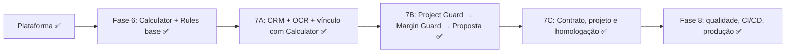

# Diagnóstico: MVP1 × desenvolvimento existente

> **Este documento é uma fotografia do começo do projeto, tirada ANTES da Fase 6.** Por isso quase tudo aparece como "Ausente". **Hoje o MVP1 inteiro foi entregue**: veja [Situação atual](#situação-atual) logo abaixo e o [roadmap](roadmap.md) (Fases 0 a 8 concluídas). A tabela e o texto originais ficam abaixo, para registro.

## Situação atual

| Item do MVP1                                                                     | Estado hoje      | Fase         | O que ainda falta (fora do escopo entregue)                                                                   |
| -------------------------------------------------------------------------------- | ---------------- | ------------ | ------------------------------------------------------------------------------------------------------------- |
| CRM essencial: cliente, lead, oportunidade, pipeline, tarefas, Project ID global | **Implementado** | 7A           | Funil personalizado por empresa (renomear, esconder, colunas próprias) também entregue                        |
| Upload de fatura                                                                 | **Implementado** | 4 e 7A       | —                                                                                                             |
| Leitura da fatura, score de confiança, confirmação manual                        | **Implementado** | 7A           | Só testada com faturas sintéticas: faltam amostras reais                                                      |
| Solar Calculator (consumo, potência, geração, economia, payback, semáforo)       | **Implementado** | 6            | Fórmulas sem fonte no EnergIF seguem como premissa declarada, a validar com especialista                      |
| Rules Engine mínimo versionado                                                   | **Implementado** | 6            | Base: ainda sem avaliador de regras por condição                                                              |
| Project Guard básico                                                             | **Implementado** | 7B           | Só verificações não regulatórias; regras por distribuidora aguardam fonte oficial e o responsável técnico     |
| Margin Guard                                                                     | **Implementado** | 7B           | —                                                                                                             |
| Proposta com snapshot imutável e rastreabilidade                                 | **Implementado** | 7B           | —                                                                                                             |
| Contrato, projeto e homologação básica                                           | **Implementado** | 7C           | Contrato-base sem revisão jurídica; a assinatura é um registro do arquivo assinado, não assinatura eletrônica |
| Isolamento por empresa, RBAC, auditoria, LGPD                                    | **Implementado** | 4, 8 e pós-8 | Sem MFA; o histórico de auditoria não é anonimizado na eliminação de dados                                    |
| Revisão humana obrigatória (leitura da fatura, exceções, decisões críticas)      | **Implementado** | 7A e 7B      | —                                                                                                             |
| Invalidação ao mudar fatura, equipamento, custo ou premissa                      | **Implementado** | 7B           | —                                                                                                             |

Também entregues depois: automações e painel comercial (7C), testes de navegador e jornada completa com vídeo, imagens de produção enxutas, servidor de teste em notebook e demonstração na nuvem com publicação automática pela `main`.

## Fotografia inicial (antes da Fase 6)

Fase 0 do [adendo de reestruturação](../00-visao-geral/adendo-reestruturacao-priorizacao.md): inspecionar o repositório e classificar cada item do MVP1 como **implementado**, **parcial**, **ausente** ou **precisa refatoração**, antes de planejar o resto. Data: 18/10/2026, após as Fases 0 a 5 e a base [EnergIF](../referencias/energif-2023/README.md). Evidências são caminhos reais do repositório.

## Resumo

- **Nada do que existe precisa ser refeito.** Nenhum item ficou como "precisa refatoração".
- **Plataforma pronta** (tenant, usuários, RBAC, auditoria imutável, eventos, documentos versionados, UI e marca): é a base de tudo o que falta.
- **Produto ainda não começou:** o MVP1 inteiro (CRM, OCR, persistência do Calculator, Rules Engine, Guard, margem e proposta) está **ausente**, exceto o **motor de cálculo puro**, que está implementado.
- Contratos em produção a preservar: API `/api/v1` (auth, tenant, branches, teams, users, invitations, documents, audit-logs, health), tabelas da plataforma e eventos `UserInvited`, `UserActivated`, `DocumentUploaded`. Mudanças futuras serão **aditivas**.

## MVP1 do adendo × estado atual

| Item do MVP1                                                                         | Estado                          | Evidência                                                                                                                                                                                                                  | O que falta                                                                                                  |
| ------------------------------------------------------------------------------------ | ------------------------------- | -------------------------------------------------------------------------------------------------------------------------------------------------------------------------------------------------------------------------- | ------------------------------------------------------------------------------------------------------------ |
| **CRM essencial:** cliente, lead, oportunidade, pipeline, tarefas, Project ID global | **Parcial (só contratos)**      | `packages/shared`: `OpportunityStage`, `DEFAULT_PIPELINE_STAGES` (15 etapas), `createLeadSchema`, `createOpportunitySchema`, `changeStageSchema`, permissões `crm.*`, eventos de domínio; web: página "em desenvolvimento" | Tabelas, API, telas, máquina de estados, tarefas, `projectCode` (Fase 7A)                                    |
| **Upload de fatura**                                                                 | **Implementado (plataforma)**   | `apps/api/src/platform/documents` (S3, versões, validação de tipo/assinatura, URL pré-assinada)                                                                                                                            | Vínculo com UC/oportunidade (7A)                                                                             |
| **OCR da fatura, score de confiança, confirmação manual**                            | **Ausente**                     | só `EnergyBillStatus` no `shared`                                                                                                                                                                                          | `BillParserProvider`, `EnergyBill`, revisão de campos incertos, `EnergyBillSnapshot` (7A)                    |
| **Solar Calculator** (consumo, potência, geração, economia, payback, semáforo)       | **Parcial (motor pronto)**      | `packages/solar-engine/src/calculator` (`runQuickCalculation`, 35 testes, cobertura > 90%), memorial `docs/06-calculos/calculator.md`                                                                                      | Persistência, API, telas, snapshot, orientação/inclinação/classe de geração, premissas visíveis (**Fase 6**) |
| **Rules Engine mínimo versionado**                                                   | **Ausente**                     | só o contrato em `docs/04-arquitetura/modulos.md`                                                                                                                                                                          | `RuleSet`/`Rule`, vigência, fonte, revisor, avaliador (**Fase 6**, base)                                     |
| **Project Guard básico**                                                             | **Ausente**                     | pré-requisitos existem: semáforo do Calculator, `TrafficLight`, `AlertSeverity`, outbox, auditoria                                                                                                                         | Módulo de triagem, estados, bloqueios, aprovação, relatório/snapshot (Fase 7B)                               |
| **Margin Guard**                                                                     | **Ausente**                     | permissões `crm.margin.*` e `ApprovalStatus` no `shared`                                                                                                                                                                   | `Quote`, `MarginPolicy`, `ApprovalRequest`, bloqueio de proposta (7B)                                        |
| **Proposta + rastreabilidade (snapshot imutável)**                                   | **Ausente**                     | padrão de imutabilidade já existe (`audit_logs` com trigger)                                                                                                                                                               | `ProposalSnapshot`, PDF/proposta web, versionamento (7B)                                                     |
| **Contrato, projeto e homologação básica** (modelagem original)                      | **Ausente**                     | —                                                                                                                                                                                                                          | Etapa 7C                                                                                                     |
| **Isolamento por empresa, RBAC, auditoria, LGPD**                                    | **Implementado** (LGPD parcial) | `apps/api/src/platform/prisma/tenant-scope.ts`, `permissions.guard.ts`, `audit`, 87 testes e2e                                                                                                                             | Criptografia de campos sensíveis, exportação/retenção (Fase 8)                                               |
| **Revisão humana obrigatória (OCR, exceções, decisões críticas)**                    | **Ausente**                     | padrão de aprovação previsto (`ApprovalStatus`)                                                                                                                                                                            | Fluxos de aprovação (7A/7B)                                                                                  |
| **Invalidação ao mudar fatura, equipamento, custo ou premissa**                      | **Ausente**                     | outbox transacional pronto                                                                                                                                                                                                 | Eventos de alteração e reavaliação (7B)                                                                      |

## Dependências e ordem

- **Fase 6 antes da 7:** o Calculator é vendável sozinho e o Rules Engine é pré-requisito do Guard.
- **7A antes de 7B:** o Guard precisa de oportunidade, UC e fatura validada.
- **7C por último:** continua no plano original, mas **pode ficar para depois da Fase 8** se o prazo apertar (decisão registrada).
- A **Fase 8** testa o fluxo completo da 7B (e o da 7C, se ela entrar).

## Riscos e lacunas que afetam o MVP1

| Risco                                                                               | Efeito                            | Tratamento                                                                                                               |
| ----------------------------------------------------------------------------------- | --------------------------------- | ------------------------------------------------------------------------------------------------------------------------ |
| Fórmulas do Calculator sem fonte no EnergIF (PR, payback, custo de disponibilidade) | Resultado preliminar não validado | Rascunho assumido e declarado; validar com especialista e o Manual CRESESB ([fontes](../referencias/fontes-oficiais.md)) |
| Sem HSP oficial embutido (licença do Atlas e ausência de base)                      | Entrada manual ou importação      | Importador CSV e provider manual; nenhum dado inventado                                                                  |
| Regras regulatórias sem fonte vigente                                               | Triagem incompleta                | Guard inicial só com verificações não regulatórias (RN-017)                                                              |
| Responsável técnico não definido                                                    | Regras não podem ir a produção    | Decisão de negócio pendente                                                                                              |
