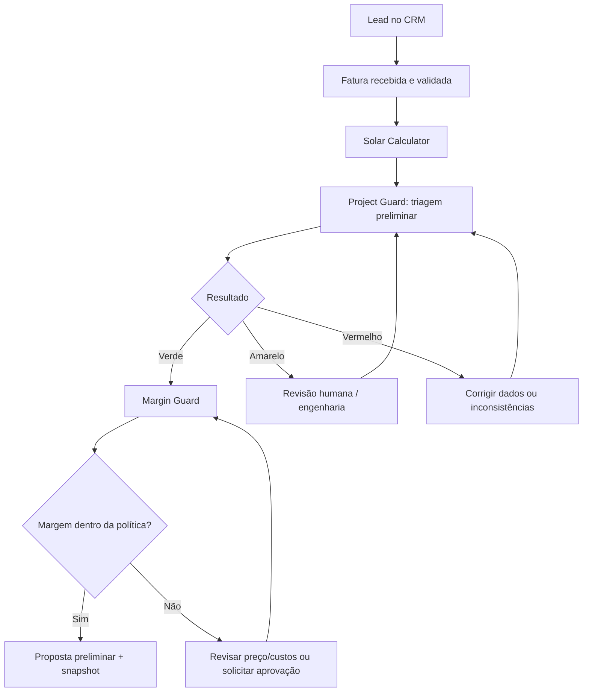

# Roadmap

Plano de implementação por fases. Cada fase termina em um checkpoint verificável. A ordem segue a seção 76 da modelagem: CRM + Calculator primeiro, depois Engine, Off-Grid e, por fim, execução e lifecycle.

| Fase | Entrega                                                                                                                                         | Status       |
| ---- | ----------------------------------------------------------------------------------------------------------------------------------------------- | ------------ |
| 0    | Bootstrap do monorepo (pnpm, Turborepo, TS, ESLint, Prettier, Husky, commitlint)                                                                | ✅ Concluída |
| 1    | Documentação (`docs/`)                                                                                                                          | ✅ Concluída |
| 2    | Pacotes compartilhados (`shared`, `solar-engine`, `ui`)                                                                                         | ✅ Concluída |
| 3    | Infra Docker (dev/prod) + banco (Prisma, migrations, seed)                                                                                      | ✅ Concluída |
| 4    | API NestJS: auth, RBAC, multi-tenant, auditoria, eventos, documentos                                                                            | ✅ Concluída |
| 5    | Web React: casca da suíte, login, navegação, admin                                                                                              | ✅ Concluída |
| 6    | **MVP1** — Solar Calculator + Rules Engine base (premissas rastreáveis, snapshot)                                                               | ✅ Concluída |
| 7A   | **MVP1** — CRM essencial: leads, oportunidades, pipeline, tarefas, fatura com OCR e integração com o Calculator                                 | ✅ Concluída |
| 7B   | **MVP1** — **Project Guard** → Margin Guard → proposta com snapshot e rastreabilidade ([ADR-0014](../04-arquitetura/adr/0014-project-guard.md)) | ⏳           |
| 7C   | **MVP1** — Contrato, projeto automático e homologação básica (pode ficar para depois da Fase 8)                                                 | ⏳           |
| 8    | Qualidade, CI/CD, imagens de produção, e2e, LGPD                                                                                                | ⏳           |
| 9    | **MVP2** — Solar Engine Studio                                                                                                                  | ⏳           |
| 10   | **MVP3** — Off-Grid Designer                                                                                                                    | ⏳           |
| 11   | Execução e lifecycle (WhatsApp, field, instalação, comissionamento, O&M, portal)                                                                | ⏳           |
| 12   | Inteligência e ecossistema (IA, procurement, previsões)                                                                                         | ⏳           |

> **Notas da Fase 3:** (1) o Prisma é o 7.x e o armazenamento S3 local é o RustFS — ver [ADR-0009](../04-arquitetura/adr/0009-prisma-7.md) e [ADR-0010](../04-arquitetura/adr/0010-rustfs-no-lugar-do-minio.md); (2) o `compose.prod.yml` traz infraestrutura + `migrate`, e os serviços `api`/`web` entram na Fase 8; (3) o pipeline padrão entra no seed junto das tabelas do CRM (Fase 7).

> **Notas da Fase 4:** (1) NestJS **11** (o 12 ainda não é suportado pelo `nestjs-zod`) — ver [API](../07-desenvolvimento/api.md); (2) o worker do outbox é um _poller_ com `FOR UPDATE SKIP LOCKED`; as filas BullMQ entram com as automações (Fase 7); (3) o registro de contas e o MFA ficam para depois: usuários entram por convite; (4) testes e2e rodam em banco `voltex_test` próprio (`pnpm test:e2e`).

> **Notas da Fase 5:** (1) React Router **8** (a API de rotas é a da v7) e Vite 8 — ver [ADR-0013](../04-arquitetura/adr/0013-arquitetura-do-front-end.md) e [Web](../07-desenvolvimento/web.md); (2) os quatro produtos aparecem no menu e no painel, cada um com uma página "em desenvolvimento" até a sua fase; (3) a identidade visual oficial (logo e paleta) foi aplicada antes da fase — ver [identidade visual](../00-visao-geral/identidade-visual.md); (4) i18n: textos em pt-BR centralizados em `i18n/labels.ts` (sem biblioteca de i18n por ora).

> **Notas da Fase 6:** (1) o Rules Engine é uma **base**: um `RuleSet` versionado com `definition` em JSON (limites e custo de disponibilidade), fonte, revisor e imutabilidade após ativar — não há ainda as tabelas `Rule` nem o avaliador de condições ([Rules Engine](../04-arquitetura/rules-engine.md)); (2) concessionárias, tarifas e irradiação são **por empresa** e **sem dado embutido**: HSP, tarifas e custo de disponibilidade vêm do cadastro/importação com fonte (nada foi inventado); (3) o cálculo oficial é o do servidor, e o resultado em tempo real do wizard usa o mesmo motor e os mesmos limites; (4) criar e ativar regras ainda é pela API (a tela de regras é somente leitura); (5) `calc-1.1.0` traz PR/perdas, orientação, inclinação recomendada, classe de geração e premissas ([memorial](../06-calculos/calculator.md)) — fórmulas ainda são rascunho até validação com Pinho & Galdino/CRESESB; (6) roteiro de teste no navegador: [verificação manual](../07-desenvolvimento/verificacao-manual.md).

> **Backlog (decisão pendente do usuário, fora das Fases 1–8):** **backoffice da plataforma** — um CRM/painel para o dono da Voltex gerenciar as **empresas clientes** (tenants): planos e contratos, cobrança/MRR, uso, suporte e saúde de cada empresa. Hoje só existe a administração **dentro** de cada empresa. Precisa de um perfil acima do tenant e acesso entre tenants com auditoria própria; vale um ADR antes de planejar.

> **Notas da Fase 7A:** (1) a leitura da fatura é uma **heurística de PDF com camada de texto** (`unpdf`), testada só com faturas sintéticas: a revisão humana é obrigatória e faltam amostras reais para medir a taxa de acerto e decidir sobre OCR/IA (a interface `BillParserProvider` já comporta); (2) a **importação de tarifas da ANEEL** entrou aqui (dados abertos, 116 distribuidoras, tarifa residencial B1 vigente, **sem impostos**); (3) o Kanban arrasta pelo ícone e tem seletor alternativo; (4) as travas de etapa (triagem e margem) entram na 7B por `OpportunitiesService.registerGate`; (5) o documento (CPF/CNPJ) segue em texto até a Fase 8 (criptografia); (6) as automações (SLA estourado → alerta, fatura não recebida → tarefa) entram na 7C; (7) detalhes em [CRM Solar](../07-desenvolvimento/crm.md).

> **Base técnica:** o desenvolvimento até a **Fase 8** usa o livro EnergIF 2023 como referência ([regras e medidas](../referencias/energif-2023/regras-e-medidas.md)); o que as Fases 6 a 8 extraem dele está mapeado na seção 6 desse documento. O restante fica inventariado para as Fases 9 a 12.

> **Escopo atual: até a Fase 8.** As Fases 9 a 12 permanecem no plano, mas fora de escopo por enquanto. A prioridade do MVP1 segue o [adendo de reestruturação](../00-visao-geral/adendo-reestruturacao-priorizacao.md): _fatura → cálculo → triagem → margem → proposta_. O estado de cada item está no [diagnóstico](diagnostico-mvp1.md) e as fontes a obter, em [fontes oficiais](../referencias/fontes-oficiais.md). Decisões: contrato/projeto/homologação ficam como etapa final 7C; o primeiro Guard usa só verificações não regulatórias.

### Fluxo prioritário do MVP1

## Fase 0 — Descoberta (negócio, paralela ao desenvolvimento)

Da seção 63: entrevistar 10–15 integradores, mapear processos reais, coletar exemplos anonimizados de contas e propostas, mapear concessionárias e fornecedores prioritários, escolher o ICP e identificar 5 clientes piloto. Resultado alimenta os dados iniciais de tarifas, HSP e parser de fatura.

## Critério do MVP1

O vendedor consegue sair de **lead + fatura para proposta preliminar** rapidamente: Lead → fatura → OCR validado → cálculo → cotação com margem → proposta PDF/web → aceite → contrato → projeto criado.

## Fora do MVP1

WhatsApp oficial (EPIC-CRM-004) e financiamento integrado (EPIC-CRM-010, no MVP1 apenas registro manual de status). Ver [o que evitar inicialmente](../00-visao-geral/visao-do-produto.md#fora-do-primeiro-mvp).

## Métricas de sucesso

- **CRM:** tempo até o primeiro valor, primeira proposta válida, conversão, ciclo de venda, negócios sem próxima tarefa, margem protegida, retrabalho, atraso de homologação.
- **Calculator:** tempo de cálculo, taxa de conclusão, correções manuais, % encaminhado ao Engine, diferença entre estimativa inicial e projeto final.
- **Engine:** tempo de projeto, revisões, incompatibilidades detectadas antes da obra, erros pós-aprovação, reutilização do catálogo, aprovação na primeira submissão.
- **Off-Grid:** tempo de dimensionamento, cenários comparados, consumo previsto × real, autonomia observada × projetada.

## Riscos

| Risco                                                    | Mitigação                                          |
| -------------------------------------------------------- | -------------------------------------------------- |
| Escopo amplo demais                                      | Produtos separados + fases                         |
| Cálculo técnico incorreto                                | Motor determinístico + testes + revisão técnica    |
| Regra desatualizada                                      | Rules Engine versionado                            |
| IA alucinar                                              | Human-in-the-loop                                  |
| API externa quebrar                                      | Integration Hub + fallback                         |
| Usuário abandonar o CRM                                  | Automação + UX + time-to-value                     |
| Dados duplicados entre sistemas                          | Source of truth + eventos + IDs globais            |
| Datasheet de equipamento errado                          | Governança de catálogo                             |
| Copiar concorrentes sem diferenciação                    | Foco em compliance + margem + engenharia conectada |
| Competir com software de engenharia completo cedo demais | Validação/integração antes de CAD avançado         |
